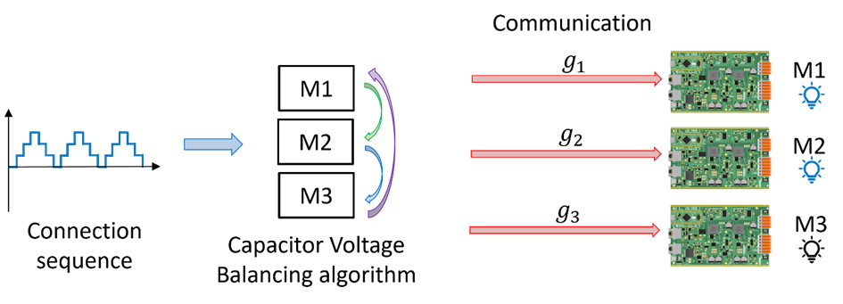
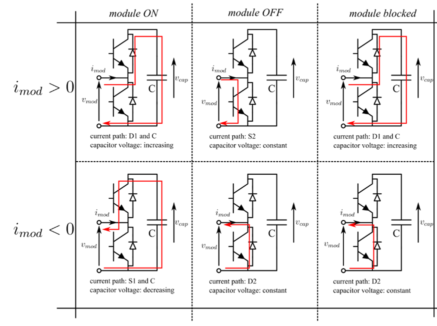
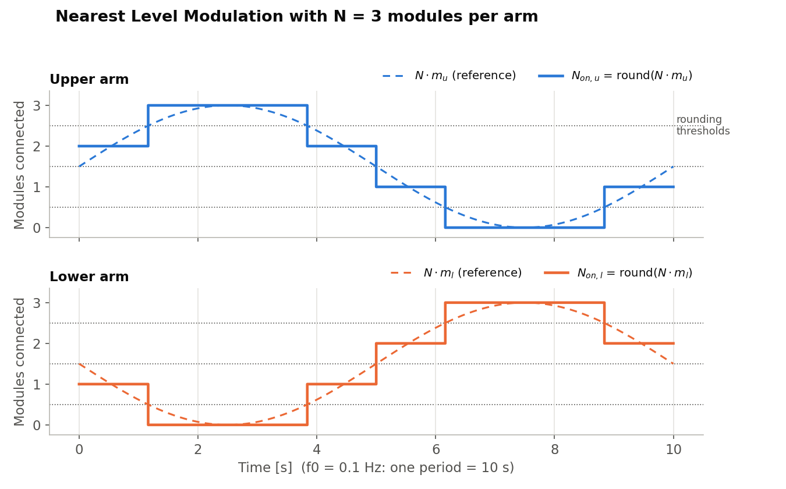
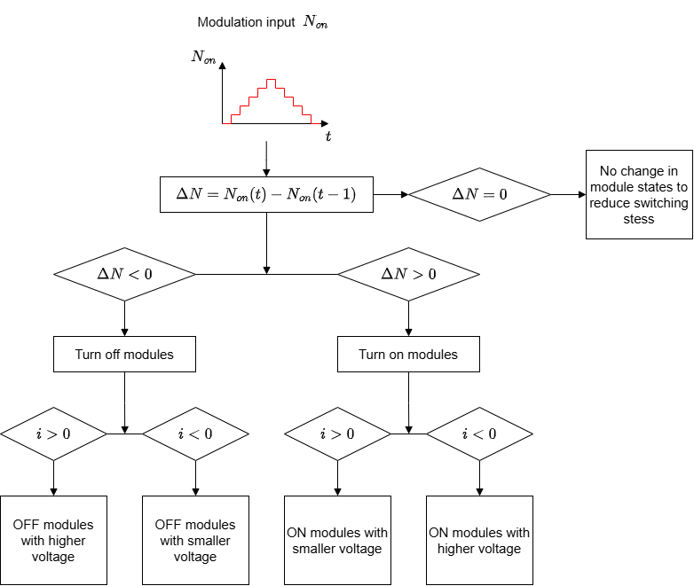
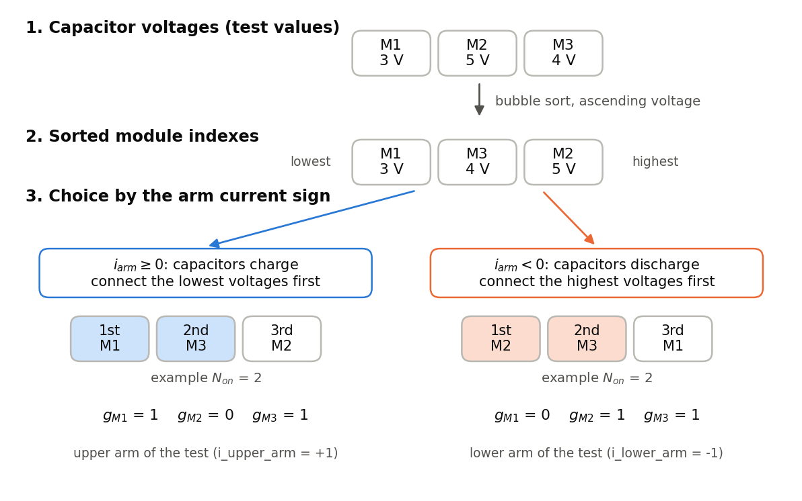
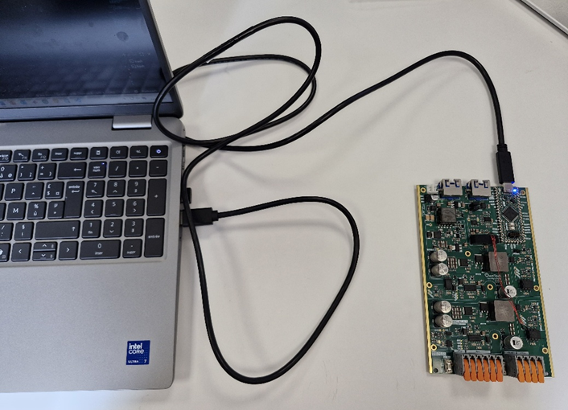
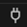
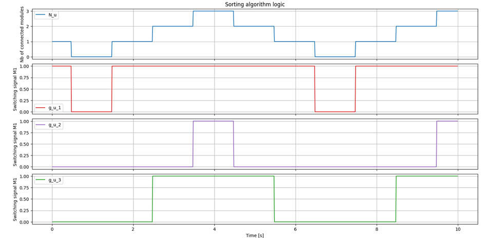
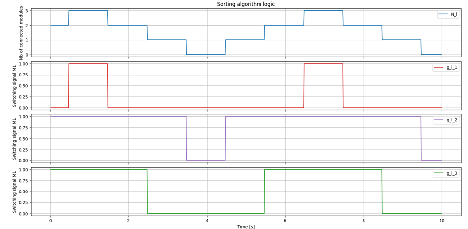

# Capacitor Voltage Balancing (CVB) algorithm logic

## Objectives

The goal of this tutorial is to test the logic of the Capacitor Voltage Balancing (CVB) algorithm on a single SPIN board, without any power circuit. The CVB algorithm is used in the MMC to create a preference order for the connection of the modules into the stack.



This algorithm is essential because the main element of each module, its capacitor, charges or discharges according to the sign of the current when the module is connected, as seen in the figure:



If the connection order is random, the capacitor voltages of the modules of one stack drift apart, which is not good for the converter operation. The CVB algorithm keeps the capacitor voltages of all modules of one stack around the same mean level.

In this test, the capacitor voltages and the arm currents are fixed test values written in the code, so you can see exactly which modules the algorithm chooses, and compare with what you expect.

## Open-loop control: NLM + CVB

The control is the same as in the [MMC phase tutorial](../Educational_prototype/phase_NLM_with_cvb/README.md), with 3 modules per arm instead of 5 and a very low frequency so that the steps can be followed on the terminal.

### Nearest Level Modulation (NLM)

The NLM modulation consists of attributing levels according to the modulation signal amplitude using the function round, such that the level attributed to the modulation signal is the nearest integer. For example, if $N \cdot m$ is 2.6, it is attributed to level 3. For the MMC, the modulation signal is a sinusoidal wave, so the NLM result is a stepped waveform. This stepped waveform indicates how many modules should be connected in the upper and lower stacks ($N_{on,u}$ and $N_{on,l}$) according to time:

$$N_{on,u} = \mathrm{round}\left(N \cdot \frac{1 + m \sin(\omega_0 t)}{2}\right) \qquad N_{on,l} = \mathrm{round}\left(N \cdot \frac{1 - m \sin(\omega_0 t)}{2}\right)$$

The two modulation signals are phase-shifted by 180°, so $N_{on,u}$ and $N_{on,l}$ are phase-shifted by 180° as well. With $N = 3$ modules per arm and $f_0 = 0.1$ Hz, one period lasts 10 s and each level lasts about 1 to 2.5 s:



### Capacitor Voltage Balancing (CVB)

The CVB algorithm chooses which modules to connect so that the capacitor voltages stay balanced. It makes its choice according to the capacitor voltages and the arm current, as described in the algorithm schematic:

- The algorithm receives the number of modules to connect $N_{on}$ from the NLM and computes its variation $\Delta N = N_{on}(t) - N_{on}(t-1)$.
- If $\Delta N = 0$, the module states do not change, which reduces the switching stress.
- If $\Delta N > 0$, $\Delta N$ modules are turned on: the modules with the **lowest** voltages if the arm current $i$ is positive (the connected capacitors charge, so their voltage increases), or the modules with the **highest** voltages if $i$ is negative (the connected capacitors discharge, so their voltage decreases).
- If $\Delta N < 0$, $\Delta N$ modules are turned off: the modules with the **highest** voltages if $i$ is positive, or the modules with the **lowest** voltages if $i$ is negative.



In the code, as in the stack and phase codes, the CVB is executed only when $N_{on}$ changes ($\Delta N \neq 0$). The modules are then sorted by capacitor voltage, and the first $N_{on}$ modules of the sorted list are connected, starting from the lowest voltage ($i_{arm} \geq 0$) or from the highest voltage ($i_{arm} < 0$); all the others are disconnected. The algorithm then generates the gate signals ($g_{M1}$, $g_{M2}$, ..., $g_{MN}$): 1 if the module is connected, 0 if it is disconnected. The figure below shows these steps with the test values of the code:



In the code, the upper arm modules are M1, M2 and M3 and the lower arm modules are M4, M5 and M6, with the same test voltages: for the lower arm, read M4, M5 and M6 in place of M1, M2 and M3 in the figure.

The CVB is executed by the functions `sorting_upper_arm()` and `sorting_lower_arm()`, only when $N_{on}$ changes in one of the arms ($\Delta N \neq 0$).

!!! note Difference with the flowchart
    The code does not only switch $|\Delta N|$ modules: at each change of $N_{on}$, it re-selects all the $N_{on}$ modules from the sorted list. With the constant test voltages, both give the same gate signals. In a real MMC, where the voltages change, re-selecting all the modules can also swap modules that were already connected: the balancing is faster, but there are more switchings.

## Required hardware

- 1 TWIST board with SPIN
- A 64-bit PC (Windows or Linux)

## Required software

- Git
- Visual Studio Code with PlatformIO

If not done yet, you should do the [Getting started tutorial on how to setup VScode for OwnTech usage](https://github.com/analuhaas/MMC/blob/main/MMC_documentation/Getting%20started/Vscode_for_OwnTech_configuration.md).

## Get tutorial code from VScode

First, we need to load the CVB control code from the OwnTech example repository version in https://github.com/analuhaas/examples
1.	In VScode, open the folder where you previously cloned OwnTech’s github.
2.	In platformio.ini file, substitute the owntech_examples variable link by https://github.com/analuhaas/examples.git
3.	Click on platform.io icon , go to Examples MMC under the Project Tasks tab and click on “CVB control”. Now you have the good code to execute the tutorial in your VScode.

## Hardware setup

4.	Connect the board to the PC using a USB to USB-C cable.



## Executing the tutorial

5.	Optional: change the test parameters in the `GENERAL MMC DEFINITIONS` block at the top of `main.cpp`:

| Parameter | Default | Meaning |
|---|---|---|
| `f0` | 0.1 Hz | Frequency of the modulation signal (one period = 10 s) |
| `total_number_of_modules_arm` | 3 | Number of modules per arm |
| `test_capacitor_voltages_upper_arm` | {3, 5, 4} V | Capacitor voltages of M1, M2, M3 |
| `test_capacitor_voltages_lower_arm` | {3, 5, 4} V | Capacitor voltages of M4, M5, M6 |
| `i_upper_arm` | +1 A | Upper arm current (only its sign is used) |
| `i_lower_arm` | −1 A | Lower arm current (only its sign is used) |

You can also change the scope configuration (`scope_period`, `NB_DATAS`) or implement and test your own sorting or CVB algorithm in `sorting_upper_arm()` and `sorting_lower_arm()`. If you change the number of modules, adapt the test voltages and the gate signals recorded by the scope (`g_u_x`, `g_l_x`).

6.	Build  and Upload  the code main.cpp into the board.
7.	Open the serial monitor using the  icon while the USB-C cable is connected to the board.
8.	Press `h` to display the help menu. The board starts in IDLE mode.
9.	Press `p` to switch to POWER mode: the NLM and the CVB start choosing the connected and disconnected modules. The LED blinks every second and the terminal prints one line per second (see [Reading the terminal output](#reading-the-terminal-output)).
10.	Press `a` to trigger the data acquisition of the ScopeMimicry scope. The scope records one point every 10 ms, so 1024 points cover about 10 s, one period of the modulation signal.
11.	Press `i` to switch to IDLE mode and stop the CVB operation.
12.	Press `r` to download the recorded data. The OwnTech serial monitor saves it in the `src/Data_records` folder.
13.	Plot the recorded data with the Python script [plot_CVB_scope_data.py](plot_CVB_scope_data.py), provided with this example. Copy it to the root of your OwnTech project (the folder that contains `src`) and run, in a terminal:

    ```bash
    pip install numpy pandas matplotlib
    python plot_CVB_scope_data.py
    ```

    The script reads the latest record of `src/Data_records` (`<date>_<time>-record.csv`), plots the number of modules to connect and the 3 gate signals of each arm against time, and saves the two figures next to the record (`..._upper_arm.png` and `..._lower_arm.png`). You can also give the record to plot, or change the time between two scope points if you changed `scope_period` (default 10 ms):

    ```bash
    python plot_CVB_scope_data.py src/Data_records/<date>_<time>-record.csv --dt 0.01
    ```

## Reading the terminal output

In POWER mode, the board prints one line per second with the NLM and CVB outputs, separated by `:`:

```text
N_u:N_l:g_u_1:g_u_2:g_u_3:g_l_1:g_l_2:g_l_3
```

| Field | Meaning |
|---|---|
| `N_u`, `N_l` | Number of modules to connect in the upper and lower arms (NLM output) |
| `g_u_1`, `g_u_2`, `g_u_3` | Gate signals of the upper arm modules M1, M2, M3 (1 = connected, 0 = disconnected) |
| `g_l_1`, `g_l_2`, `g_l_3` | Gate signals of the lower arm modules M4, M5, M6 |

With the default test values, the lines follow this sequence over one period of 10 s:

| Time (s) | `N_u` | `N_l` | `g_u_1` `g_u_2` `g_u_3` | `g_l_1` `g_l_2` `g_l_3` |
|---|---|---|---|---|
| 0 – 1.2 | 2 | 1 | 1 0 1 | 0 1 0 |
| 1.2 – 3.8 | 3 | 0 | 1 1 1 | 0 0 0 |
| 3.8 – 5.0 | 2 | 1 | 1 0 1 | 0 1 0 |
| 5.0 – 6.2 | 1 | 2 | 1 0 0 | 0 1 1 |
| 6.2 – 8.8 | 0 | 3 | 0 0 0 | 1 1 1 |
| 8.8 – 10 | 1 | 2 | 1 0 0 | 0 1 1 |

For example, the line `2:1:1:0:1:0:1:0` means that 2 upper modules are connected (M1 and M3, the two lowest voltages) and 1 lower module is connected (M5, the highest voltage). Check that the number of 1 in the upper gate signals is always equal to `N_u`, and in the lower gate signals to `N_l`.

## Expected results

By plotting the recorded data with `plot_CVB_scope_data.py`, you will have results like these for the upper arm:



These results use the capacitor voltages `test_capacitor_voltages_upper_arm` = {3, 5, 4} V and `i_upper_arm` = +1 A ($i \geq 0$). The algorithm connects the modules with the lowest voltages first, so the preference of connection is $g_{u1} \rightarrow g_{u3} \rightarrow g_{u2}$: `g_u_1` is 1 as soon as $N_u \geq 1$, `g_u_3` joins it when $N_u \geq 2$, and `g_u_2` is only 1 when $N_u = 3$.

You can plot the same for the lower arm, with `test_capacitor_voltages_lower_arm` = {3, 5, 4} V and `i_lower_arm` = −1 A ($i < 0$). The algorithm connects the modules with the highest voltages first, so the preference of connection is $g_{l2} \rightarrow g_{l3} \rightarrow g_{l1}$:



To fully understand the CVB algorithm, you can play with:

- the capacitor voltages (for example, equal voltages for all modules),
- the sign of the arm currents,
- the number of modules,
- the modulation frequency and the scope configuration.

## Link with the real MMC

The functions `sorting_upper_arm()` and `sorting_lower_arm()` of this test are the same as in the [MMC stack](../Educational_prototype/stack_with_cvb/README.md) and [MMC phase](../Educational_prototype/phase_NLM_with_cvb/README.md) codes. The difference is where their inputs come from:

| Input | This test | Real MMC (stack and phase codes) |
|---|---|---|
| Capacitor voltages | Fixed test values (`test_capacitor_voltages_upper_arm`, `test_capacitor_voltages_lower_arm`) | Measured by each module and sent to the lead board over RS-485 (`MMC_capacitor_voltage`) |
| Arm currents | Fixed test values (`i_upper_arm`, `i_lower_arm`) | Measured by the first module of each arm and sent to the lead board (`MMC_arm_current`) |
| Gate signals | Recorded by the scope and printed on the terminal | Sent by the lead board to each module over RS-485, which switches its half-bridge |
| Number of modules | 3 per arm | 5 per arm |
| Modulation frequency | 0.1 Hz | 50 Hz |

In the real MMC, the capacitor voltages change every time a module is connected, so the sorted order changes during operation and the CVB keeps the voltages balanced. In this test, the voltages are constant, so the order is always the same, which makes the logic easy to check.
