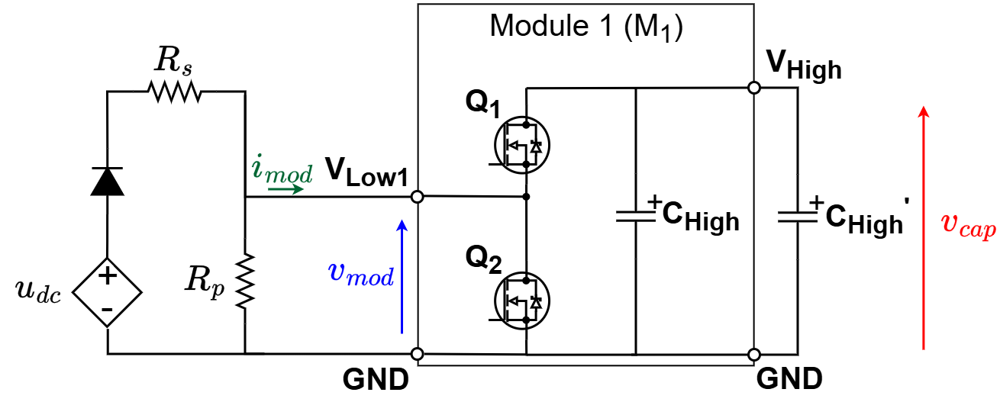
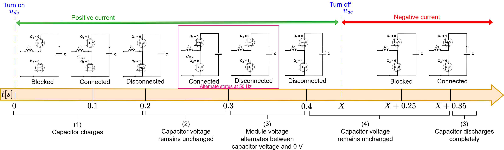
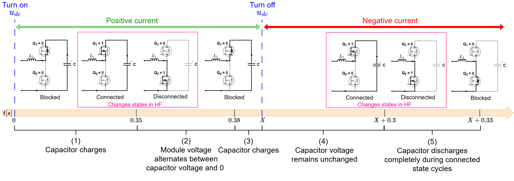
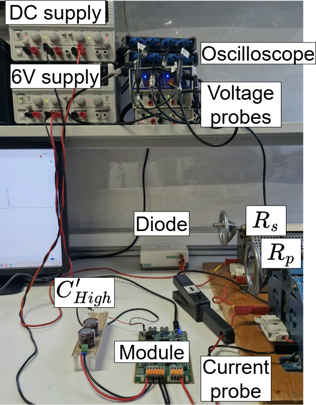

# MMC module test sequences

Remark: The difference between this test and the original module tests of previous versions is that the code was modified to no longer need programmable DC power supply.

## Objectives and context

The goal of this tutorial is to test a individual MMC module operation in all its states in both low and high frequency. For that, we used the circuit structure below. $R_{p}$ resistance is connected in parallel to the module in order to emulated negative currents discharging the module capacitor. An additional capacitor $C_{High}'$ can be connected to the VHigh and GND in parallel to $C_{High}$ in order to increase the module capacitance.

The board serves as a HB module of the MMC by programming its second leg (LEG2) to be deactivated, having the following circuit. Observe that the HIGH terminals are open (Vhigh to GND).

The tutorial will consist of putting the module M1 in Disconnected, Connected and Blocked states according to the correspondence table below:

| State | $i_{mod}$ | $Q1$ | $Q2$ | $Q3$ | $Q4$ | $Q5$ | $Q6$ | $v_{mod}$ |
| --- | --- | --- | --- | --- | --- | --- | --- | --- |
| Connected (C) | +/- | <code style="color : green">Closed</code> | <code style="color : red">Open</code> | <code style="color : red">Open</code> | <code style="color : red">Open</code> | <code style="color : red">Open</code> | <code style="color : red">Open</code> | $+v_{cap}$ |
| Disconnected (D) | +/- | <code style="color : red">Open</code> | <code style="color : green">Closed</code>  | <code style="color : red">Open</code> | <code style="color : red">Open</code> | <code style="color : red">Open</code> | <code style="color : red">Open</code> | $0$ |
| Blocked (B) | - | <code style="color : red">Open</code> | <code style="color : red">Open</code> | <code style="color : red">Open</code> | <code style="color : red">Open</code> | <code style="color : red">Open</code> | <code style="color : red">Open</code> | $+v_{cap}$ |
| Blocked (B) | + | <code style="color : red">Open</code> | <code style="color : red">Open</code> | <code style="color : red">Open</code> | <code style="color : red">Open</code> | <code style="color : red">Open</code> | <code style="color : red">Open</code> | $0$ |

The module state is controlled using the board first leg (LEG1) switches Q1 and Q2 command:

Connected state:
- $Q1$ MOSFET is <code style="color : green">Closed</code> and $Q2$ MOSFET is <code style="color : red">Open</code>.
- The module is said to be connected to the circuit, contributing to the stack with its capacitor voltage and the current pass through its capacitor.

Disconnected state:
- $Q1$ MOSFET is <code style="color : red">Open</code> and $Q2$ MOSFET is <code style="color : green">Closed</code>.
- The module is said to be bypassed from the circuit, so it does not contribute to the stack voltage and no current pass through its capacitor.

Blocked state:
- $Q1$ MOSFET is <code style="color : red">Open</code> and $Q2$ MOSFET is <code style="color : red">Open</code>.
- Since both MOSFETs are open, only anti-parallel diodes conducts. Which diodes conducts will depend only if current sign is positive or negative.

## Test sequences

The module is tested with two sequences: a low-frequency (LF) sequence and a high-frequency (HF) sequence. Both test the three states (connected, disconnected and blocked) with positive and negative module current, and both are split in two parts:

- **Positive current part**: starts when you turn on the DC supply $u_{dc}$ (t = 0). The supply drives the current in the positive sense of $i_{mod}$, charging the module capacitor.
- **Negative current part**: starts when you turn off $u_{dc}$ (instant X on the timelines). The capacitor is then at a higher voltage than the left side of the circuit ($u_{dc}$ and resistors), so the current can only flow in the negative sense of $i_{mod}$, which lets you observe the capacitor discharge through $R_p$.

### Low-frequency sequence

**Objective:** verify that the TWIST/SPIN board is correctly programmed and behaves like a half-bridge module, staying long enough in each state to observe it.

| Part | Time | State | What is observed |
|---|---|---|---|
| Positive current | 0 – 0.1 s | Blocked | (1) Capacitor charges |
| | 0.1 – 0.2 s | Connected | (1) Capacitor charges |
| | 0.2 – 0.3 s | Disconnected | (2) Capacitor voltage remains unchanged |
| | 0.3 – 0.4 s | Connected / Disconnected at 50 Hz | (3) Module voltage alternates between capacitor voltage and 0 V |
| | 0.4 s – X | Disconnected | (4) Capacitor voltage remains unchanged |
| Negative current | X – X+0.25 s | Disconnected | (4) Capacitor voltage remains unchanged |
| | X+0.25 – X+0.35 s | Blocked | (4) Capacitor voltage remains unchanged |
| | after X+0.35 s | Connected | (5) Capacitor discharges completely |

### High-frequency sequence

**Objective:** verify that the module operates correctly at higher switching frequencies, from 50 Hz (NLM operation) up to the kHz range (PWM). Instead of staying in one state, the module alternates between connected and disconnected at the target switching frequency during short windows.

| Part | Time | State | What is observed |
|---|---|---|---|
| Positive current | 0 – 0.35 s | Blocked | (1) Capacitor charges |
| | 0.35 – 0.38 s | Connected / Disconnected in HF | (2) Module voltage alternates between capacitor voltage and 0 V |
| | 0.38 s – X | Blocked | (3) Capacitor charges |
| Negative current | X – X+0.3 s | Blocked | (4) Capacitor voltage remains unchanged |
| | X+0.3 – X+0.33 s | Connected / Disconnected in HF | (5) Capacitor discharges completely during the connected state cycles |
| | after X+0.33 s | Blocked | (6) Capacitor voltage remains at 0 V |

!!! warning Reminder
    You must manually TURN ON the $u_{dc}$ power supply to start the positive current part, and TURN OFF $u_{dc}$ to start the negative current part.

## Required Hardware list:
- 1 TWIST boards with SPIN
- DC Power Supply (48 V, 2 A)
- Protection diode (at least 50 V)
- 2 resistors of 30 $\Omega$
- PC 64-bits (windows or linux)
- Oscilloscope
- Current probe
- 2 BNC adaptors to differential voltage measurement or differential probes

## Required Software list:
- Git
- Visual Studio Code with PlatformIO

If not done yet, you should do the [Getting started tutorial on how to setup VScode for OwnTech usage](https://github.com/analuhaas/MMC/blob/main/MMC_documentation/Getting%20started/Vscode_for_OwnTech_configuration.md).

## Get tutorial code from VScode

First, we need to load the Single module test code from the OwnTech example repository version in https://github.com/analuhaas/examples 
1.	In VScode, open the folder where you previously cloned OwnTech’s github.
2.	In platformio.ini file, substitute the owntech_examples variable link by https://github.com/analuhaas/examples.git 
3.	Click on platform.io icon , go to Examples MMC under the Project Tasks tab and click on “MMC module test sequence – LF” or “MMC module test sequence – HF”. Now you have the good code to execute the tutorial in your VScode.

## Minor hardware modifications and calibration

Repeat for the stack modules boards, if not done yet:

4.	Recommended for a typical MMC behavior: Configure all 5 modules boards with the minor hardware modifications indicated in the [tutorial](https://github.com/analuhaas/MMC/blob/main/MMC_documentation/Prototype%20tutorials/twist_modifications_MMC_tutorial.md).

5.  Calibrate the module sensors. You can do it in two ways:
    - manually, reading the measurements on the serial monitor and computing the gains and offsets in a spreadsheet, as explained in the [manual calibration tutorial](https://github.com/analuhaas/MMC/blob/main/MMC_documentation/Prototype%20tutorials/module_calibration_tutorial.md);
    - automatically, with MATLAB and a PicoScope acquiring the measurements and computing the gains and offsets, as explained in the [automated calibration tutorial](https://github.com/analuhaas/MMC/blob/main/MMC_documentation/Prototype%20tutorials/module_calibration_automated_tutorial.md).

## Module hardware setup

6.	Connect the module to an External Auxiliary DC Power Supply to the TWIST via the 6 V and 6VGND PINs. Make sure the External Auxiliary DC Power Supply is configured to deliver 6 V with limiting current above 0.5 A. Make sure these power supplies OUTPUT IS OFF.
7.	Connect the board with the power supply, the $R_s$ and $R_p$ resistances and PC as in the image: 

8.	Connect the oscilloscope to measure: module capacitor voltage $v_{cap}$, module voltage $v_{mod}$ and current $i_{mod}$, and DC voltage $u_{dc}$.

After making the connections and connecting the PC to board the USB-C cable, you should have something like this:

9.	Configure your Oscilloscope. Recommended configurations are:
- 200 ms/div configuration with sampling interval around 1 µs (x5 smaller than critical task period)
- Trigger when the stack voltage rises up to 2 V.

## Executing the LF module test

10.	Verify you got correct test code using “MMC module LF test sequence” button.
11.	Build  and Upload  the code main.cpp into the board.
12.	Make sure the 6 V External Auxiliary DC Power Supply is configured to deliver 6 V with limiting current above 0.5 A. TURN ON the External Auxiliary DC Power Supply output.

The boards starts in IDLE mode (equal to module blocked state).
13.	TURN ON the main power supply output. This will start the sequence first part (positive current).
14.	After you verify the first sequence part is finished (after 0.5 s), TURN OFF the main power supply output. This will start the sequence second part.
15.	Save your oscilloscope data.

## Stopping tutorial

16.	TURN OFF the 6V External Auxiliary DC Power Supply output.

## Expected results for the LF module test

In the low-frequency sequence, the module expected behavior is as shown in the figure below if you perform the minor hardware modifications recommended for MMC usage:

## Executing the HF module test

17.	Verify you got correct test code using “MMC module HF test sequence”  button.
18.	Build  and Upload  the code main.cpp into the board.
19.	Make sure the 6 V External Auxiliary DC Power Supply is configured to deliver 6 V with limiting current above 0.5 A. TURN ON the External Auxiliary DC Power Supply output.

The boards starts in IDLE mode (equal to module blocked state).
20.	TURN ON the main power supply output. This will start the sequence first part (positive current).
21.	After you verify the first sequence part is finished (after 0.5 s), TURN OFF the main power supply output. This will start the sequence second part.
22.	Save your oscilloscope data.

## Stopping tutorial

23.	TURN OFF the 6 VExternal Auxiliary DC Power Supply output.

## Expected results for the HF module test

In the high-frequency sequence, the module expected behavior is as shown in the figure below if you perform the minor hardware modifications recommended for MMC usage:

