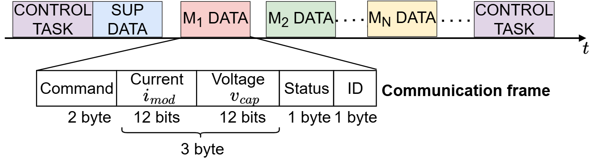
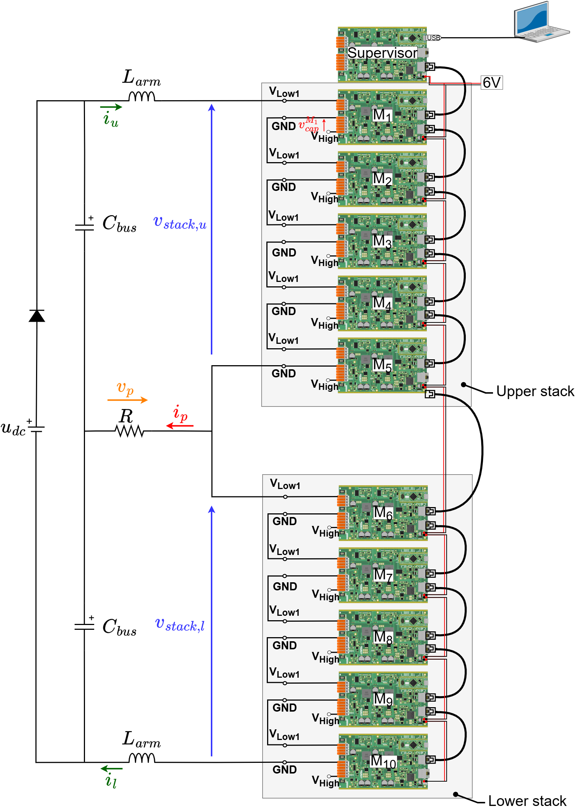
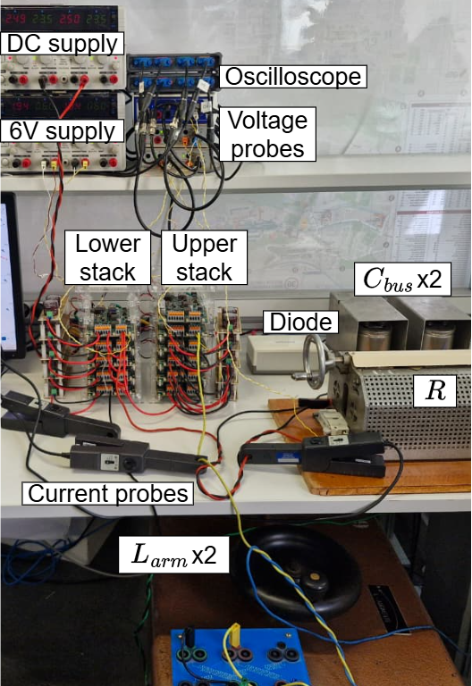

# MMC phase in open-loop

## Objectives and context

The objective of this task is to build a MMC phase considering that we already have two MMC stacks of 5 modules usign TWIST boards. Open-loop control using NLM modulation strategy with CVB is implemented. For that, we use the circuit structure below.


As in the individual module test, the boards serves as a HB module of the MMC by programming its second leg (LEG2) to be deactivated, having the following circuit. Observe that the HIGH terminals are open (Vhigh to GND).


## Open-loop control

The NLM modulation consists of attributing levels according to the modulation signal amplitude using the function round such that the level attributed to the modulation signal is the nearest integer and its principle is represented in the figure. For example, if the modulation signal is 2.6, it is going to be attributed to level 3. For the MMC, the modulation signal is a sinusoidal wave, making that the NLM modulation result is a stepped wave-form. This stepped wave-form output of the NLM indicates how many modules should be connected in the upper or lower stack ($N_{on}$) according to time.


The CVB algorithm consists of choosing which modules to connect in order to have equilibrated voltage between all modules. The CVB algorithm makes is choice according to measured capacitor voltages and stack current as described in the algorithm schematic. It then generates the command to connect or disconnect the modules by setting the gate command signals ($g_{M1}$, $g_{M2}$,..., $g_{MN}$), to 1 (module connected) or 0 (module disconnected).


The complete schematic of the open-loop control implemented in this prototype is represented in the figure below. We see that each stack modulation signal are phase-shifted of 180°, which implies that $N_{on,u}$ and $N_{on,l}$ are phase-shifted of 180° as well.


## Communication architecture

A communication layer using RS-485 protocol allows the modules to exchange information with the supervisor via RJ45 cables. The communication message (frame) is structured as shown in the figure below. The supervisor’s reception function treats received frames and uses the first module of both stacks as the stack current for the CVB algorithm. Module status indicates if an error occurred or overvoltage/overcurrent limit is exceeded.



We can see the complete communication architecture and how it connects with the MCU control in the supervisor and modules boards in the figure below. The converter operating mode is set by the PC keyboard command via USB-C cable. In IDLE mode, all modules are blockes. In POWER mode, NLM + CVB is applied and the converter operates normally. The modules are synchronized to the supervisor’s clock via the OwnTech boards sync protocol over RJ45 cables.


## Required Hardware list
- 11 TWIST boards with SPIN
- 2 DC power supply of 6 V with minimum 2 A
- 2 DC power supply of 48 V with minimum 3 A
- 2 Protection diodes (at least 200 V)
- 2 DC bus capacitors around 4400 µF
- 2 stack inductances around 30 mH
- 10 extra capacitors for modules (used extra 1100 µF)
- 1 resistor of 15 $\Omega$
- 10 ethernet cables
- PC 64-bits (windows or linux)
- Oscilloscope (PicoScope used as default)
- Current probes
- Differential probes for voltage measurements

Optional: if you want to build a transparent rack as the one we use, you can use its [project](https://github.com/analuhaas/MMC/blob/main/MMC_documentation/Prototype%20tutorials/Rack_project/1Rack_20251007.svg).The rack was built by cutting acrylic plates with laser.

## Required Software list
- Git
- Visual Studio Code with PlatformIO.

If not done yet, you should do the [Getting started tutorial on how to setup VScode for OwnTech usage](https://github.com/analuhaas/MMC/blob/main/MMC_documentation/Getting%20started/Vscode_for_OwnTech_configuration.md).

## Get tutorial code from VScode

First, we need to load the base code from the stack test with CVB in the OwnTech example repository version in https://github.com/analuhaas/examples 
1.	In VScode, open the folder where you previously cloned OwnTech’s github.
2.	In platformio.ini file, substitute the owntech_examples variable link by https://github.com/analuhaas/examples.git 
3.	Go to platform.io icon , go to Examples MMC under the Project Tasks tab and click on “MMC phase”.
4.	Now you have the good code to start in your VScode.

## Modules hardware setup and test

If not done before, repeat for the stack modules boards:

4.	Recommended for a typical MMC behavior: Configure all 5 modules boards with the minor hardware modifications indicated in the [tutorial](https://github.com/analuhaas/MMC/blob/main/MMC_documentation/Prototype%20tutorials/twist_modifications_MMC_tutorial.md).

5.  Calibrate the module sensors. You can do it in two ways:
    - manually, reading the measurements on the serial monitor and computing the gains and offsets in a spreadsheet, as explained in the [manual calibration tutorial](https://github.com/analuhaas/MMC/blob/main/MMC_documentation/Prototype%20tutorials/module_calibration_tutorial.md);
    - automatically, with MATLAB and a PicoScope acquiring the measurements and computing the gains and offsets, as explained in the [automated calibration tutorial](https://github.com/analuhaas/MMC/blob/main/MMC_documentation/Prototype%20tutorials/module_calibration_automated_tutorial.md).

6.	Test the module using the low-frequency and high-frequency sequences as explained in the [tutorial](https://github.com/analuhaas/MMC/blob/main/MMC_documentation/Prototype%20tutorials/module_test_sequences_tutorial.md).

## Stack setup and test

If stacks not done yet, repeat for the upper and lower stacks the [stack test tutorial](https://github.com/analuhaas/MMC/blob/main/MMC_documentation/Prototype%20tutorials/stack_NLM_CVB_test_tutorial.md). Be sure to verify if the current and voltage measurements of the modules are calibrated.

## Phase setup 

The theorical and experimental implementation electrical circuits for the single-phase are described in the figure below. The steps to achieve this configuration are:

5.	Connect the upper and lower stacks in series using VLOW1 and GND terminals to form an MMC phase using banana cables.
6.	Connect each module of the phase to the External Auxiliary DC Power Supply via the 6 V and DGND white PINs. Use one External Auxiliary DC Power Supply for each stack or connect the stacks 6 V in parallel. Make sure that the External Auxiliary DC Power Supplies are configured to deliver 6 V with limiting current of 2 A. Make sure the power supply OUTPUT IS OFF.
7. Add extra 1.1 mF capacitance in parallel to Vhigh and DGND terminals to increase module capacitor ($𝐶= C_{extra} + 𝐶_{𝐻𝑖𝑔ℎ} \approx 1300 \mu 𝐹$).
8.	Connect the controller board and all modules by ethernet cables as in the image.
9.	Connect the stack to the DC power supply using the protection diode, $𝐶_{𝑏𝑢𝑠}$ DC bus capacitors, $L_{arm}$ inductors and R load resistance. Configure the DC power supply to 48 V.


10.	Connect the oscilloscope to measure the electrical quantities you want. The recommended measurements are listed below. If you don't have enough channels to measure all capacitors voltages, you can get its data using the supervisor scope acquisition (step 22, then step 26).
    - Upper arm voltage ($v_{stack,u}$)
    - Lower arm voltage ($v_{stack,l}$)
    - Phase voltage ($v_{p}$)
    - Upper arm current ($i_{stack,u}$)
    - Lower arm current ($i_{stack,l}$)
    - Phase current ($i_{p}$)
    - Capacitor voltages ($v_{cap}$)

After making the connections and connecting the PC to the central controller board with the USB-C cable, you should have a physical implementation like this:



12.	Configure your Oscilloscope (PicoScope or other). Recommended configurations are:
- 10 ms/div configuration with sampling interval around 1 µs (x5 smaller than critical task period)
- Trigger when the stack voltage rises up to 2 V.

## Executing the tutorial Phase test

13. Verify you got correct test code using “MMC phase”  button.
14.	Optional: Change the test parameters to have a more specific test:

  a.	In code: NLM frequency, number of modules.

  b.	In circuit: Number of modules, resistance values (to reduce or increase current), DC supply voltage.

15. Repeat to all 5 module boards $M_1$, $M_2$, $M_3$, $M_4$, $M_5$:
    a.  Connect the board to the PC via a USB-C cable.
    b.  If the module needs specific calibration value, insert this code snippet on setup_routine(). Change the module ID and the gain and offset to correspond to the good module and calibration.

        ``` ruby
        if(module_ID == MMC_Mx)
            {
                shield.sensors.setConversionParametersLinear(V_HIGH,gain,offset);
                shield.sensors.setConversionParametersLinear(V1_LOW,gain,offset);
                shield.sensors.setConversionParametersLinear(V2_LOW,gain,offset);
                shield.sensors.setConversionParametersLinear(I1_LOW,gain,offset);
                shield.sensors.setConversionParametersLinear(I2_LOW,gain,offset);
                shield.sensors.setConversionParametersLinear(I_HIGH,gain,offset);

            }
        ```
    c.  Build  and Upload  the code main.cpp into the board.
    d.  Open the serial monitor and copy the board ID to the identification list in the code according to its function in the stack
        ``` ruby
        /* -------------- BOARD IDENTIFICATION ----------------------- */
        /* --------------- To be changed by user --------------------- */

        constexpr uint32_t UID_MMC_LEAD_BOARD = 0x002B002A;
        constexpr uint32_t UID_MMC_M1_BOARD = 0x0033004C;
        constexpr uint32_t UID_MMC_M2_BOARD = 0x0031001B;
        constexpr uint32_t UID_MMC_M3_BOARD = 0x00330049;
        constexpr uint32_t UID_MMC_M4_BOARD = 0x0033004B;
        constexpr uint32_t UID_MMC_M5_BOARD = 0x00330054;
        constexpr uint32_t UID_MMC_M6_BOARD = 0x0032003F;
        constexpr uint32_t UID_MMC_M7_BOARD = 0x004E0048;
        constexpr uint32_t UID_MMC_M8_BOARD = 0x00470026;
        constexpr uint32_t UID_MMC_M9_BOARD = 0x004C001D;
        constexpr uint32_t UID_MMC_M10_BOARD = 0x0047002B;
        ```

     e. Do again: Build  and Upload  the code main.cpp into the board.
16. Connect the board to the PC via a USB-C cable. Let the USB-C cable connected to the Supervisor board during the test.
17. Build  and Upload  the code main.cpp into the Supervisor board.
18. Make sure the External Auxiliary DC Power Supplies are configured to deliver 6 V with limiting current at max 2 A. TURN ON the External Auxiliary DC Power Supplies output.
19. After the capacitor voltages comes back to 0, TURN ON the main power supply $u_{dc}$.
20. After the modules are charged with stable voltages more and less at the same level, click “p” to start phase operation with NLM (with CVB).
21. Save your oscilloscope results.
22. To acquire the boards internal capacitor voltages, press "a", wait for 1 minute, then press "r".

## Stopping tutorial

23. TURN OFF the main power supply $u_{dc}$. This will discharge the modules capacitors.
24. Click “i” to stop phase operation and put all modules in IDLE mode (blocked state).
25. TURN OFF all 6V External Auxiliary DC Power Supplies.

## Plotting data from supervisor scope

26. Treat the resulting csv data from supervisor scope to obtain the capacitors voltage using the [tutorial](../../Other/scopemimicry_plot/README.md). Any change in the scope variables will need code adaptation.

## Expected results

If you perform the phase test at 50 Hz, you should expect an experimental result like this:


We see that the stack voltages, $v_{stack,u}$  and $v_{stack,l}$, exhibits six-step staircase waveforms with homogeneous voltage levels maintained by the CVB algorithm. The stack voltages are phase-shifted by 180° and generate a phase voltage $v_p$ centered at 0 V. The phase voltage close to a sinusoidal waveform due to arm inductors filter. The phase current $i_p$ is in phase with the phase voltage because the load is resistive.

