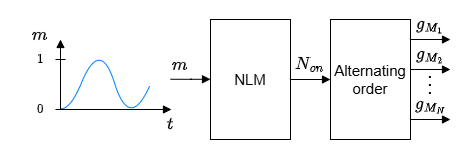
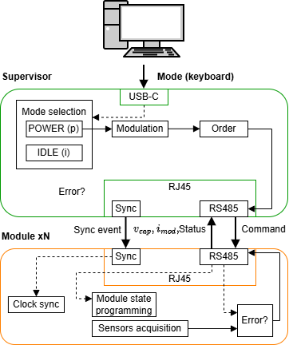
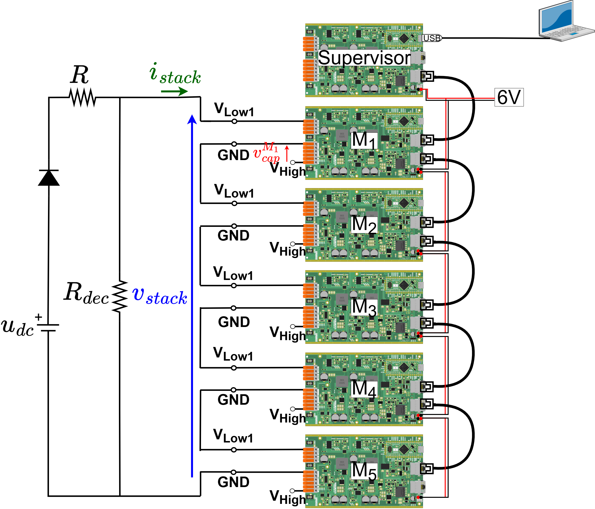

# MMC stack tutorial without CVB

## Objectives and context

The goal of this tutorial is to test a MMC stack built with TWIST boards operation with open-loop control using NLM modulation strategy without capacitor voltage balancing (CVB): the modules are connected following an alternating order. For that, we use the circuit structure below. $R_{p}$ resistance is connected in parallel to the stack in order to emulate negative currents discharging the modules capacitor.


As in the individual module test, the boards serves as a HB module of the MMC by programming its second leg (LEG2) to be deactivated, having the following circuit. Observe that the HIGH terminals are open (Vhigh to GND).


## Open-loop control

The NLM modulation consists of attributing levels according to the modulation signal amplitude using the function round such that the level attributed to the modulation signal is the nearest integer and its principle is represented in the figure. For example, if the modulation signal is 2.6, it is going to be attributed to level 3. For the MMC, the modulation signal is a sinusoidal wave, making that the NLM modulation result is a stepped wave-form. This stepped wave-form output of the NLM indicates how many modules should be connected in the stack ($N_{on}$) according to time.


In this tutorial, no capacitor voltage balancing (CVB) algorithm is used: the modules to connect are not chosen from the measured capacitor voltages. Instead, the NLM output $N_{on}$ is applied following an **alternating order** of the modules, which changes at every period of the modulation signal. The complete schematic of the open-loop control implemented in this prototype is represented in the figure:


The alternating order block works as follows:

- **Connection order:** the modules are kept in an ordered list. At each control step, the first $N_{on}$ modules of the list are connected (gate signal $g_{Mx}$ = 1) and the others are disconnected ($g_{Mx}$ = 0).
- **Order rotation:** at the start of each new period of the modulation signal (every 20 ms at 50 Hz), the list is shifted by one module: the module that was first goes to the end of the list.
- **Result:** after $N$ periods, every module has been in every position of the list once, so all modules are connected for the same total time. On average, their capacitors receive and deliver the same charge, which keeps the capacitor voltages close to each other without measuring them.

For example, with $N$ = 5 modules:

| Period | Connection order | Connected modules when $N_{on}$ = 2 |
|---|---|---|
| 1 | M1 > M2 > M3 > M4 > M5 | M1, M2 |
| 2 | M2 > M3 > M4 > M5 > M1 | M2, M3 |
| 3 | M3 > M4 > M5 > M1 > M2 | M3, M4 |
| 4 | M4 > M5 > M1 > M2 > M3 | M4, M5 |
| 5 | M5 > M1 > M2 > M3 > M4 | M5, M1 |
| 6 | M1 > M2 > M3 > M4 > M5 | M1, M2 (the cycle restarts) |

In the code, this is done in `loop_critical_task()` by the lead board: when the angle of the modulation signal wraps back to 0 (new period), `rotation_offset` is incremented and the list `modules_indexes_upper_arm` is rebuilt starting from the module `rotation_offset`. The gate signals are then set by connecting the first `number_of_connected_modules_upper_arm` modules of this list.

!!! note Difference with CVB
    The alternating order only balances the capacitor voltages on average over $N$ periods. Within one period, the voltages can drift apart, for example if the modules have different capacitances or losses. The CVB algorithm, used in the [stack with CVB tutorial](../stack_with_cvb/README.md), corrects this by choosing the modules from their measured voltages and the stack current sign.

## Communication architecture

A communication layer using RS-485 protocol allows the modules to exchange information with the supervisor via RJ45 cables. The communication message (frame) is structured as shown in the figure below. Module status indicates if an error occurred or overvoltage/overcurrent limit is exceeded.


We can see the complete communication architecture and how it connects with the MCU control in the supervisor and modules boards in the figure below. The converter operating mode is set by the PC keyboard command via USB-C cable. In IDLE mode, all modules are blocked. In POWER mode, NLM with the alternating connection order is applied and the converter operates normally. The modules are synchronized to the supervisor’s clock via the OwnTech boards sync protocol over RJ45 cables.



## Required Hardware list

- 6 TWIST boards with SPIN
- 6 independent DC power supplies of 6 V with minimum 0.5 A
- 1 DC power supply of (48 V, 5 A)
- Protection diode (at least 100 V)
- 2 resistors of 30 $\Omega$
- 5 ethernet cables
- PC 64-bits (windows or linux)
- Oscilloscope
- Current probe
- 6 BNC adaptors to differential voltage measurement

Optional: if you want to build a transparent rack as the one we use, you can use its [project](https://github.com/analuhaas/MMC/blob/main/MMC_documentation/Prototype%20tutorials/Rack_project/1Rack_20251007.svg).The rack was built by cutting acrylic plates with laser.

## Required Software list

- Git
- Visual Studio Code with PlatformIO

If not done yet, you should do the [Getting started tutorial on how to setup VScode for OwnTech usage](https://github.com/analuhaas/MMC/blob/main/MMC_documentation/Getting%20started/Vscode_for_OwnTech_configuration.md).

## Get tutorial code from VScode

First, we need to load the Stack without CVB code from the OwnTech example repository version in https://github.com/analuhaas/examples 
1.	In VScode, open the folder where you previously cloned OwnTech’s github.
2.	In platformio.ini file, substitute the owntech_examples variable link by https://github.com/analuhaas/examples.git 
3.	Click on platform.io icon , go to Examples MMC under the Project Tasks tab and click on “MMC stack without CVB”. Now you have the good code to execute the tutorial in your VScode.

## Modules hardware setup

Repeat for the stack modules boards, if not done yet:

4.	Recommended for a typical MMC behavior: Configure all 5 modules boards with the minor hardware modifications indicated in the [tutorial](https://github.com/analuhaas/MMC/blob/main/MMC_documentation/Prototype%20tutorials/twist_modifications_MMC_tutorial.md).

5.  Calibrate the module sensors. You can do it in two ways:
    - manually, reading the measurements on the serial monitor and computing the gains and offsets in a spreadsheet, as explained in the [manual calibration tutorial](https://github.com/analuhaas/MMC/blob/main/MMC_documentation/Prototype%20tutorials/module_calibration_tutorial.md);
    - automatically, with MATLAB and a PicoScope acquiring the measurements and computing the gains and offsets, as explained in the [automated calibration tutorial](https://github.com/analuhaas/MMC/blob/main/MMC_documentation/Prototype%20tutorials/module_calibration_automated_tutorial.md).

6.	Test the module using the low-frequency and high-frequency sequences as explained in the [tutorial](https://github.com/analuhaas/MMC/blob/main/MMC_documentation/Prototype%20tutorials/module_test_sequences_tutorial.md).

## Stack Hardware setup

7.	Connect the boards in series using VLOW1 and GND terminals to form an MMC stack using banana cables.
8.	Connect to each module an External Auxiliary DC Power Supply to the TWIST via the 6 V and 6VGND PINs. Make sure the External Auxiliary DC Power Supplies are configured to deliver 6 V with limiting current above 0.5 A. Make sure these power supplies OUTPUT IS OFF.
9.	Connect the boards using ethernet cables between all modules and supervisor stack.
10.	Connect the stack to the main DC power supply, $R_s$ and $R_p$_ resistances and diode.



11.	Connect the oscilloscope to measure: all modules capacitor voltage $v_{cap}$, the stack voltage $v_{stack}$ and current $i_{stack}$. If you don't have enough channels to measure all capacitors voltages, you can get its data using the supervisor scope acquisition (step 22, then step 26).

After making the connections and connecting the PC to the central controller board with the USB-C cable, you should have a physical implementation like this:


12.	Configure your Oscilloscope. Recommended configurations are:
- 10 ms/div configuration with sampling interval around 1 µs (x5 smaller than critical task period)
- Trigger when the stack voltage rises up to 2 V.

## Executing the tutorial Stack test

13.	Verify you got correct test code using “MMC stack without CVB” button.
14.	Optional: Change the test parameters to have a more specific test:

  a.	In code: NLM frequency, number of modules.

  b.	In circuit: Number of modules, resistance values (to reduce or increase current), DC supply voltage.
  
  
15.	Repeat to all module boards $M_1$, $M_2$, $M_3$, $M_4$, $M_5$:
  
  a.	Connect the board to the PC via a USB-C cable.

  b.  If the module needs specific calibration value, insert this code snippet on setup_routine(). Change the module ID and the gain and offset to correspond to the good module and calibration.

        ``` ruby
        if(module_ID == MMC_Mx)
            {
                shield.sensors.setConversionParametersLinear(V_HIGH,gain,offset);
                shield.sensors.setConversionParametersLinear(V1_LOW,gain,offset);
                shield.sensors.setConversionParametersLinear(V2_LOW,gain,offset);
                shield.sensors.setConversionParametersLinear(I1_LOW,gain,offset);
                shield.sensors.setConversionParametersLinear(I2_LOW,gain,offset);
                shield.sensors.setConversionParametersLinear(I_HIGH,gain,offset);

            }
        ```
  
  c.	Build  and Upload  the code main.cpp into the board.
  
  d.	Open the serial monitor and copy the board ID to the identification list in the code according to its function in the stack


```
  /* -------------- BOARD IDENTIFICATION ----------------------- */
  
  
  constexpr uint32_t UID_MMC_LEAD_BOARD = 0x002B002A;
  
  constexpr uint32_t UID_MMC_M1_BOARD = 0x00330054;
  
  constexpr uint32_t UID_MMC_M2_BOARD = 0x0033004B;
  
  constexpr uint32_t UID_MMC_M3_BOARD = 0x00330049;
  
  constexpr uint32_t UID_MMC_M4_BOARD = 0x0033004C;
  
  constexpr uint32_t UID_MMC_M5_BOARD = 0x0031001B;
  
  constexpr uint32_t UID_MMC_M6_BOARD = 0x11118888;
  
  constexpr uint32_t UID_MMC_M7_BOARD = 0x11119999;
  
  constexpr uint32_t UID_MMC_M8_BOARD = 0x1111AAA0;
  
  constexpr uint32_t UID_MMC_M9_BOARD = 0x1111BBB1;
  
  constexpr uint32_t UID_MMC_M10_BOARD = 0x1111CCC2;
```


  e.	Do again: Build  and Upload  the code main.cpp into the board.


16. Build  and Upload  the code main.cpp into the Central Controller board.
17. Make sure the External Auxiliary DC Power Supply is configured to deliver 6 V with limiting current at 2 A. TURN ON the External Auxiliary DC Power Supplies output.
18. After the capacitor voltages comes back to 0, TURN ON the main power supply $u_{dc}$.
19. After the modules are charged with stable voltages more and less at the same level, click “p” to start stack operation with NLM.
20. Save your oscilloscope results.
21. To acquire the boards internal capacitor voltages, press "a", wait for 1 minute, then press "r".

## Stopping tutorial

22. TURN OFF the main power supply $u_{dc}$. This will discharge the modules capacitors.
23. Click “i” to stop stack operation and put all boards in IDLE mode (blocked state).
24. TURN OFF all 6V External Auxiliary DC Power Supplies.

## Plotting data from supervisor scope

26. Treat the resulting csv data from supervisor scope to obtain the capacitors voltage using the [tutorial](../../Other/scopemimicry_plot/README.md). Any change in the scope variables will need code adaptation.

## Expected results

If you perform the stack test with CVB using circuit#1 at 50 Hz, you should expect an experimental result like this:


We see that the stack produces a voltage v_stack with a six-step staircase waveform, consistent with the expected behavior of using control with NLM modulation. The steps of the staircase are homogenous due to the CVB algorithm, which keeps the capacitor voltages $v_{cap}$ balanced. The stack current $i_{stack}$ also presents a staircase waveform, since no inductance is used in this test.