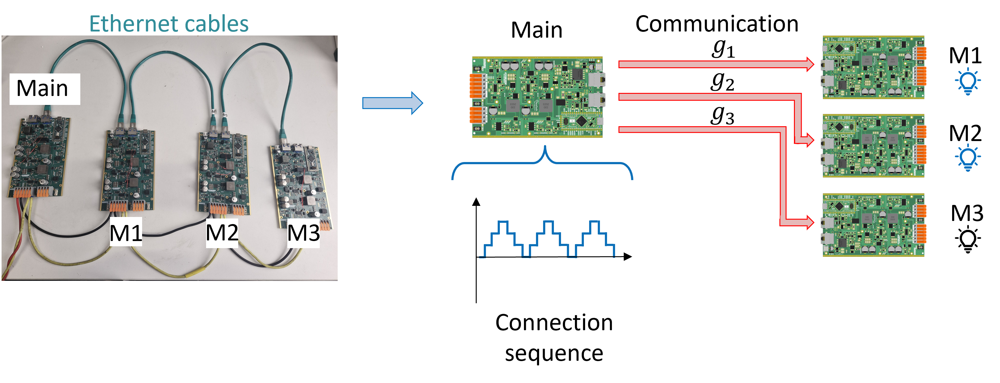
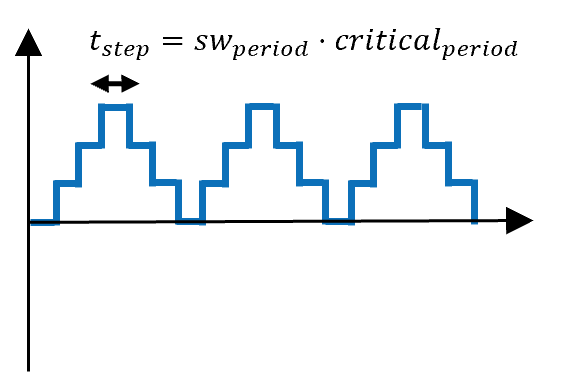
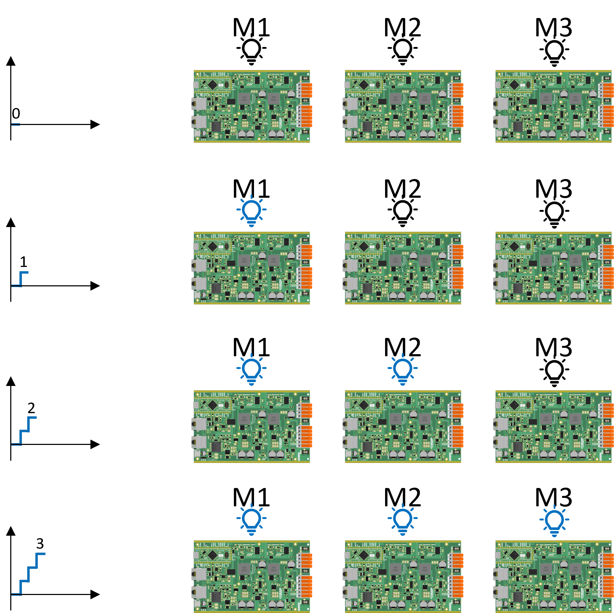
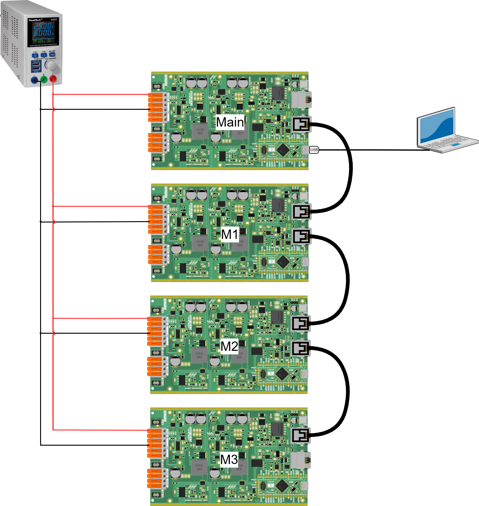
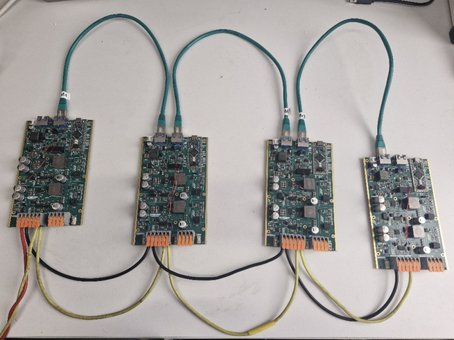
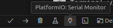

# Blinky MMC arm

The goal of this tutorial is to do a first MMC arm without using power with the following structure:



The main board serves as the central controller in the classical structure of the MMC. It will generate a connection sequence going from 0 to 3 that indicates how many modules should be connected. Then, it choses which modules to connect according to the preset preference order M1 → M2 → M3.

Then, the main board sends the connection commands g1, g2 and g3 via the Ethernet cables to the M1, M2 and M3 boards. If the board receives the command to be connected, it turns ON its SPIN board LED. If the board receives the command to be disconnected, it turns OFF its SPIN board LED.

## Required Hardware

•	4 TWIST boards with SPIN

•	DC Power Supply (48 V, 2 A)

•	3 Ethernet cables (RJ45)

•	Cables to connect with the power supply

•	PC 64-bits (windows or linux)

## Required Software

•	Git

•	Visual Studio Code with PlatformIO 

Before you can run this example, you must have successfully gone through the [Getting started tutorial on how to setup VScode for OwnTech usage](https://github.com/analuhaas/MMC/blob/main/MMC_documentation/Getting%20started/Vscode_for_OwnTech_configuration.md).

## Get tutorial code from VScode

First, we need to load the Blinky MMC stack code from the OwnTech example repository version in https://github.com/analuhaas/examples 
1.	In VScode, open the folder where you previously cloned OwnTech’s github.
2.	In platformio.ini file, substitute the owntech_examples variable link by https://github.com/analuhaas/examples.git 
3.	Go to platform.io icon , go to Examples MMC under the Project Tasks tab and click on “Blinky MMC arm”.
4.	Now you have the good code to execute the tutorial in your VScode.


#### Connection sequence

The connection sequence has a specific frequency set by the variable sw_period and the critical task period.



The value of the connection sequence signal corresponds to the number of modules to insert. Then, using the preset connection order, we have:



#### Communication structure

In the critical task, when POWER mode is activated, data transmission is first started sending the data structure dataTX_mmc from #LEAD to all #SMx.

The data structure sent is defined as:
```
dataTX_mmc or dataRX_mmc
└─ command
└─ capacitor_voltage
└─ status
└─ ID
```
In which:
- command = command to be inserted (1) or bypassed (0) sent to the module
- capacitor_voltage = stores the measured capacitor voltage on the #SMx
- status = flag corresponding to POWER (1) or IDLE (0) mode
- ID = identification of the board as #LEAD or #SMx

After the #LEAD starts the transmission, the reception_function is used in the receiver to store the information and continue the transmission sequence to the next board with sequence LEAD → M3 → M2 → M1

## Hardware setup

5.	Connect the 4 TWIST/SPIN board with the DC power supply as in the image below.
6.	Connect the 4 TWIST/SPIN boards together via ethernet cables to enable communication as in the image below.
7.	Connect the Main TWIST/SPIN board with the PC as in the image below using a USB to USB-C cable.



After making the connections and connecting the PC to the main with the USB-C cable, you should have something like this:



!!! note Powering the boards
    We connect the boards in series and set the power supply to 15 V in order to power the boards Auxiliary Power Supplies (APS). This is necessary because the APS is used to power the communication devices and the microcontroller of the boards.

!!! warning Boards modified for MMC
    If you made the module modifications of the [TWIST modifications for MMC tutorial](https://github.com/analuhaas/MMC/blob/main/MMC_documentation/Prototype%20tutorials/twist_modifications_MMC_tutorial.md), the internal APS of the boards is disconnected from the power circuit (jumper JP5001 cut), so the 15 V supply no longer powers them. In this case, connect the 6 V and 6VGND pins of each board to an auxiliary DC power supply set to 6 V, with current limit above 0.5 A.

## Executing the tutorial

8.	Optional: Change switching frequency using sw_period variable (default 10000 equivalent to 1 Hz)
9.	Repeat for all 4 boards:
    - Build  and Upload  main.cpp code to the board changing the variable module_ID to MMC_LEAD, MMC_SM1, MMC_SM2 or MMC_SM3 according to the board function.

```
/* --------------USER VARIABLES DECLARATIONS------------------- */

/* TODO : Define module_ID depending on the ID of the board */
uint8_t module_ID = MMC_SM1; // The ID of the module, can be set to MMC_LEAD or any other SMx
```

10.	Open the serial monitor using the  icon with USB-C cable connected with the master, as shown in the hardware setup.
11.	Press h to display the help menu.
12.	Turn on the power supply around 15 V to power the 4 SPIN boards (or the 6 V auxiliary power supplies, if your boards were modified for MMC). The main and M1, M2 and M3 boards starts in IDLE mode.
13.	Press p to switch to POWER mode and the modules LEDs will start to light up and off according to the connection sequence.
14.	Press i to switch to IDLE mode and stop the stack operation.
15.	Turn off the power supply.

## Expected results during POWER mode

The video below shows the modules LEDs lighting up and off according to the connection sequence and the preset connection order M1 → M2 → M3.

<video src="figures/Blinky_results.mp4" controls width="600"></video>

If the video does not play, open it directly: [Blinky_results.mp4](figures/Blinky_results.mp4).
