# MMC stack JCGE - with CVB using 0.9 duty cycle during connected state

## Objectives and context

The goal of this tutorial is to test a MMC stack built with TWIST boards operation with open-loop control using NLM modulation strategy with CVB. For that, we use the two circuit structure below. $R_{dec}$ resistance is connected in parallel to the stack for circuit #2 in order to emulate negative currents discharging the modules capacitor.

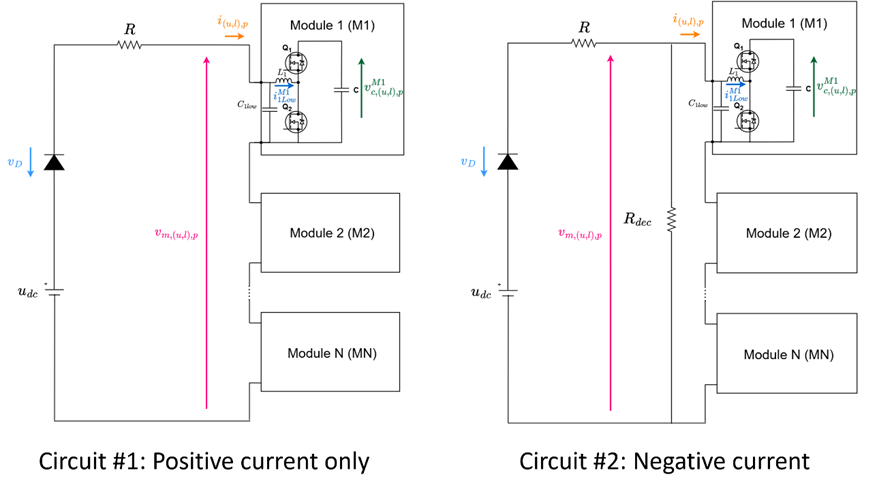

As in the individual module test, the boards serves as a HB module of the MMC by programming its second leg (LEG2) to be deactivated, having the following circuit. Observe that the HIGH terminals are open (Vhigh to GND).


## Open-loop control

The NLM modulation consists of attributing levels according to the modulation signal amplitude using the function round such that the level attributed to the modulation signal is the nearest integer and its principle is represented in the figure. For example, if the modulation signal is 2.6, it is going to be attributed to level 3. For the MMC, the modulation signal is a sinusoidal wave, making that the NLM modulation result is a stepped wave-form. This stepped wave-form output of the NLM indicates how many modules should be connected in the stack ($N_{on}$) according to time.


The CVB algorithm consists of choosing which modules to connect in order to have equilibrated voltage between all modules. The CVB algorithm makes is choice according to measured capacitor voltages and stack current as described in the algorithm schematic. It then generates the command to connect or disconnect the modules by setting the gate command signals ($g_{M1}$, $g_{M2}$,..., $g_{MN}$), to 1 (module connected) or 0 (module disconnected).


The complete schematic of the open-loop control implemented in this prototype is represented in the figure:


### Difference with the arm CVB example

The difference between this example and the arm CVB example is that a 0.9 duty cycle is used during connected state instead of 1. This is alternative used to maintain the bootstrap capacitor charged. The modification is in the line of code:

```
shield.power.setDutyCycle(LEG1,0.9); // Duty cycle = 0.9 makes Q1 mostly closed and Q2 mostly open
```

## Required Hardware list

- 6 TWIST boards with SPIN
- 6 independent DC power supplies of 6 V with minimum 0.5 A
- 1 DC power supply of (48 V, 5 A)
- Protection diode (at least 100 V)
- 2 resistors of 15\ \Omega
- 5 ethernet cables
- PC 64-bits (windows or linux)
- Oscilloscope
- Current probe
- 6 BNC adaptors to differential voltage measurement

## Required Software list

- Git
- Visual Studio Code with PlatformIO

If not done yet, you should do the [Getting started tutorial on how to setup VScode for OwnTech usage](https://github.com/analuhaas/MMC/blob/main/MMC_documentation/Getting%20started/Vscode_for_OwnTech_configuration.md).

## Get tutorial code from VScode

First, we need to load the MMC stack JCGE with CVB code from the OwnTech example repository version in https://github.com/analuhaas/examples 
1.	In VScode, open the folder where you previously cloned OwnTech’s github.
2.	In platformio.ini file, substitute the owntech_examples variable link by https://github.com/analuhaas/examples.git 
3.	Go to platform.io icon , go to Examples MMC JCGE under the Project Tasks tab and click on “MMC stack JCGE – with CVB”.
4.	Now you have the good code to execute the tutorial in your VScode.

## Modules hardware setup

Repeat for the 5 modules boards, if not done yet:

5.	Recommended for a typical MMC behavior: Configure all 5 modules boards with the minor hardware modifications indicated in the [tutorial](../twist_modifications_MMC_module/twist_modifications_MMC_JCGE_tutorial.md). They include feeding the 6 V auxiliary input externally with the feeder disconnected from the board circuit (jumper JP5001 cut).

6.  Calibrate the module sensors. You can do it in two ways:
    - manually, reading the measurements on the serial monitor and computing the gains and offsets in a spreadsheet, as explained in the [manual calibration tutorial](https://github.com/analuhaas/MMC/blob/main/MMC_documentation/Prototype%20tutorials/module_calibration_tutorial.md);
    - automatically, with MATLAB and a PicoScope acquiring the measurements and computing the gains and offsets, as explained in the [automated calibration tutorial](https://github.com/analuhaas/MMC/blob/main/MMC_documentation/Prototype%20tutorials/module_calibration_automated_tutorial.md).

7.	Test the module using the [low-frequency](../mmc_module_lf_test_modified/README.md) and [high-frequency](../mmc_module_hf_test_modified/README.md) test sequences.

## Stack Hardware setup

8.	Connect the boards in series using VLOW1 and GND terminals to form an MMC stack using banana cables (figure below).
9.	Connect to each module an External Auxiliary DC Power Supply to the TWIST via the 6 V and DGND PINs. Make sure the External Auxiliary DC Power Supplies are configured to deliver 6 V with limiting current above 0.5 A. Make sure these power supplies OUTPUT IS OFF (figure below).
10.	Connect the boards using ethernet cables as in the image (figure below).
11.	Connect the stack to the main DC power supply, R and Rdec resistances and diode (figure below).

!!! If using circuit#1, remove Rdec from the circuit. If using circuit #2, circuit exactly as in the image.

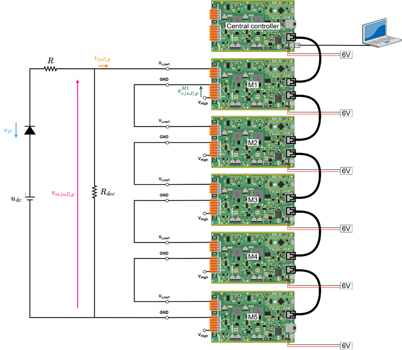

12.	Connect the voltage and current measurements with the oscilloscope (figure below). 

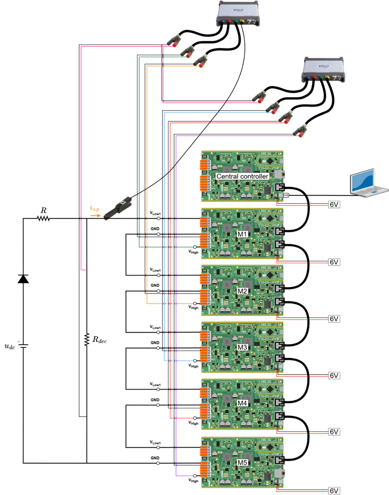

After making the connections and connecting the PC to the central controller board with the USB-C cable, you should have something like this:

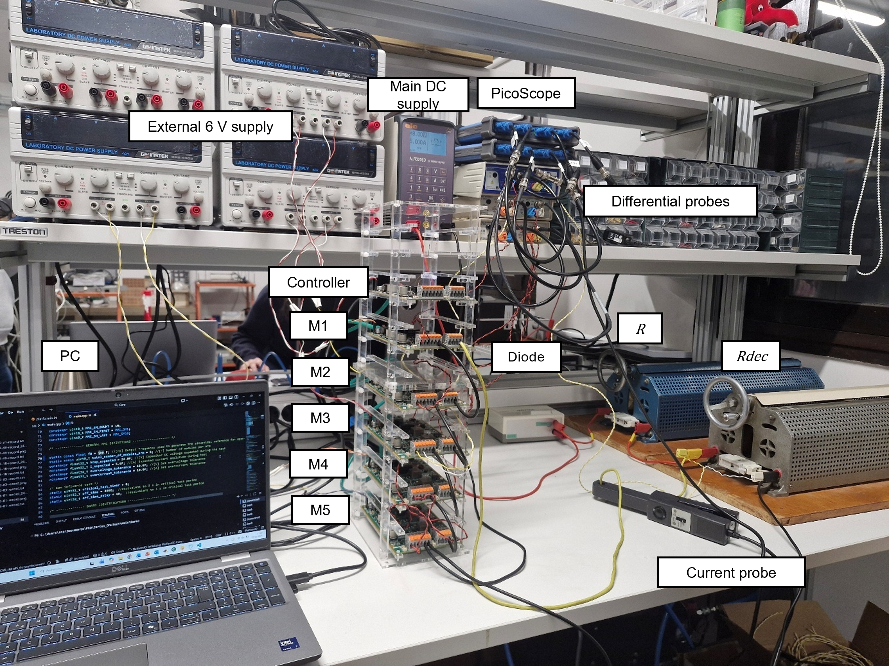

13.	Configure your Oscilloscope with PicoScope (tutorial using PicoScope 4444)

a.	Make sure it acquires the following measurements:

i.	Modules capacitor voltages (Vhigh to GND).

ii.	Stack current.

iii.	Stack voltage.

b.	Use a 10 s/div configuration with sampling interval around 1 µs (x5 smaller than critical task period)

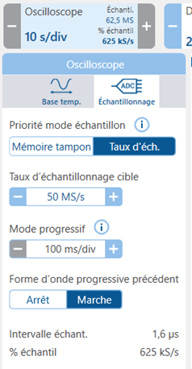

c.	Configure it to trigger when the stack voltage rises up to 2 V.

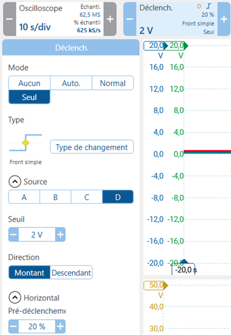

## Executing the tutorial Stack test

14.	Get the correct test code using “MMC stack JCGE – with CVB”  button.
15.	Optional: Change the test parameters to have a more specific test:

  a.	In code: NLM frequency, number of modules.

  b.	In circuit: Number of modules, resistance values (to reduce or increase current), DC supply voltage.
  
  
16.	Repeat to all 5 module boards M1, M2, M3, M4, M5:
  
  a.	Connect the board to the PC via a USB-C cable.
  
  b.	Build  and Upload  the code main.cpp into the board.
  
  c.	Open the serial monitor and copy the board ID to the identification list in the code according to its function in the stack


```
  /* -------------- BOARD IDENTIFICATION ----------------------- */
  
  
  constexpr uint32_t UID_MMC_LEAD_BOARD = 0x002B002A;
  
  constexpr uint32_t UID_MMC_M1_BOARD = 0x00330054;
  
  constexpr uint32_t UID_MMC_M2_BOARD = 0x0033004B;
  
  constexpr uint32_t UID_MMC_M3_BOARD = 0x00330049;
  
  constexpr uint32_t UID_MMC_M4_BOARD = 0x0033004C;
  
  constexpr uint32_t UID_MMC_M5_BOARD = 0x0031001B;
  
  constexpr uint32_t UID_MMC_M6_BOARD = 0x11118888;
  
  constexpr uint32_t UID_MMC_M7_BOARD = 0x11119999;
  
  constexpr uint32_t UID_MMC_M8_BOARD = 0x1111AAA0;
  
  constexpr uint32_t UID_MMC_M9_BOARD = 0x1111BBB1;
  
  constexpr uint32_t UID_MMC_M10_BOARD = 0x1111CCC2;
```


  d.	Do again: Build  and Upload  the code main.cpp into the board.


17. Build  and Upload  the code main.cpp into the Central Controller board.
18. Make sure all modules External Auxiliary DC Power Supply are configured to deliver 6 V with limiting current above 0.5 A. TURN ON the External Auxiliary DC Power Supplies output.
19. After the capacitor voltages comes back to 0, TURN ON the main power supply $u_{dc}$.
20. After the modules are charged with stable voltages more and less at the same level, click “p” to start stack operation with NLM (with or without CVB).
21. After 20 s, TURN OFF the main power supply $u_{dc}$.
22. Click “i” to stop stack operation and put all boards in IDLE mode (blocked state).
23. TURN OFF all 6V External Auxiliary DC Power Supplies.

## Expected results

If you perform the stack test with CVB using circuit#1 at 50 Hz, you should expect an experimental result like this:

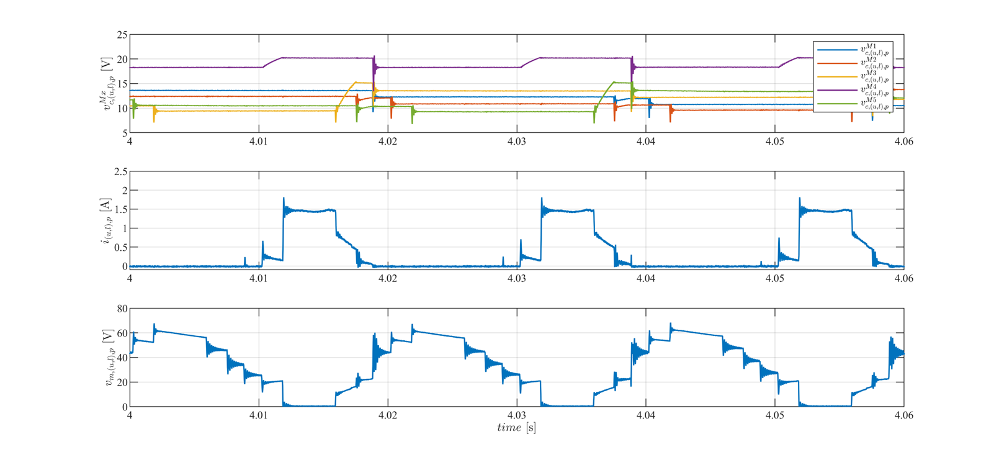

We see that in the higher voltage level (5th level), where all modules should be connected to the arm, the arm voltage presents a great discharge effect while the module capacitor voltages remains at same level. By comparing the sum of capacitor voltages with the arm voltage, we can see that they are different:

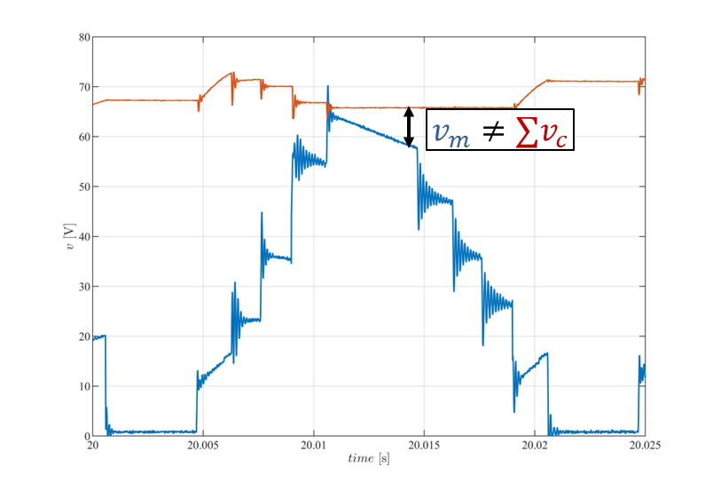

This made us conclude that the modules changed to blocked state due to the bootstrap capacitor discharge, as verified in this test:

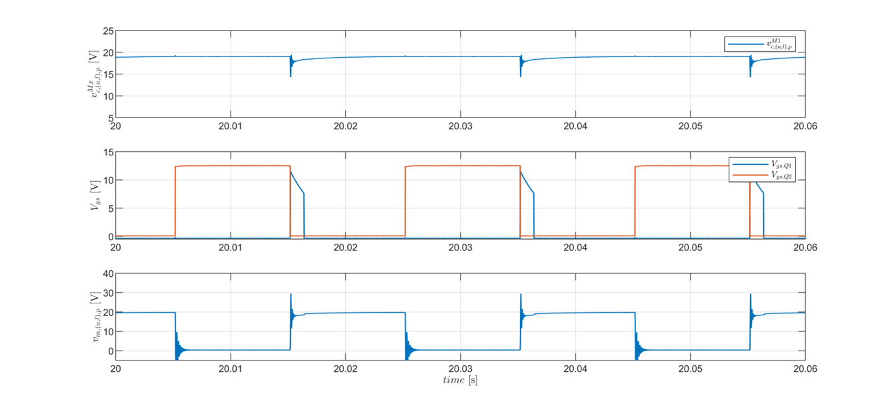

Using the 0.95 duty cycle code in this example, we performed the stack test with CVB using circuit#1 at 50 Hz and got a experimental result like this:

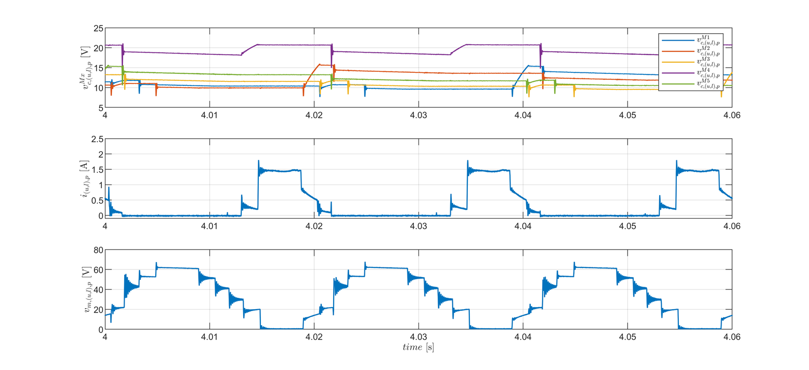

We can see that the discharge in the higher voltage level (5th level) was reduced since modules stays at "connected state", which is confirmed by the comparison of the sum of capacitor voltages with the arm voltage:

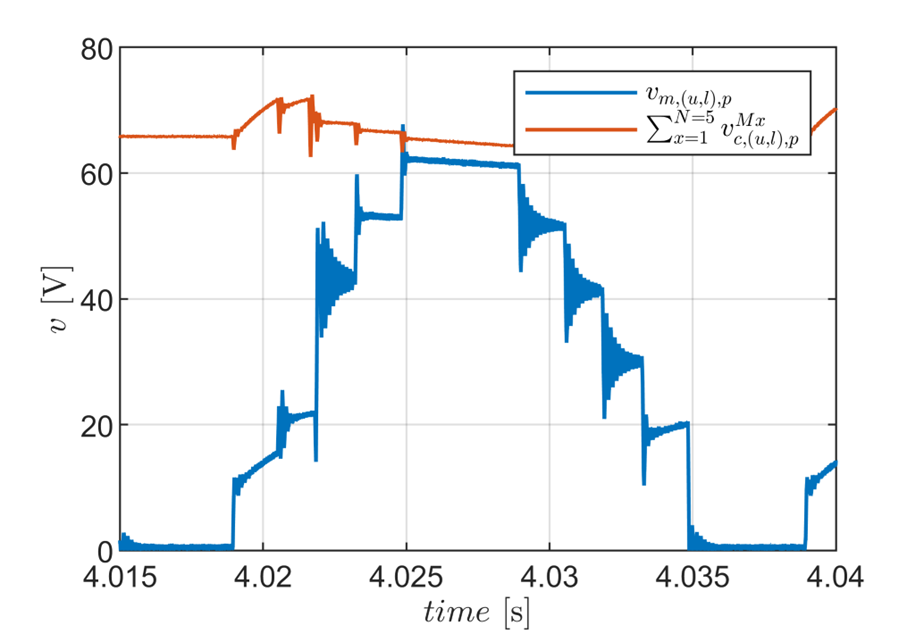

We can see now that the capacitor voltages discharges with the arm voltage. The difference between arm voltage and sum of capacitors voltage is from buck effect.
