# MMC module JCGE- Low-frequency test (modified)

## Objectives and context

The goal of this tutorial is to test a individual MMC module operation in all its states in both low frequency. For that, we used the circuit structure below. R_{dec} resistance is connected in parallel to the module in order to emulated negative currents discharging the module capacitor.

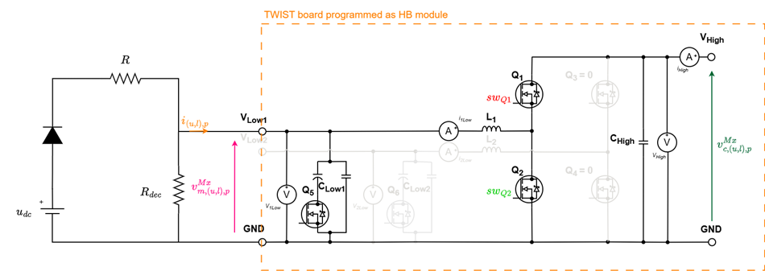

The board serves as a HB module of the MMC by programming its second leg (LEG2) to be deactivated, having the following circuit. Observe that the HIGH terminals are open (Vhigh to GND).

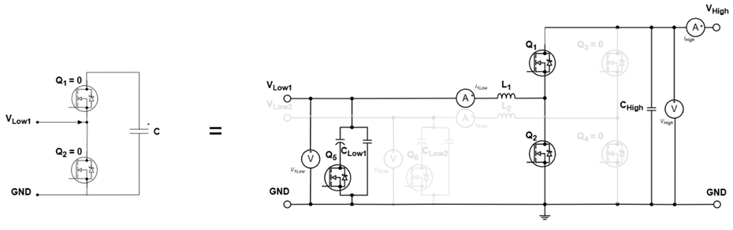

The tutorial will consist of putting the module M1 in Disconnected, Connected and Blocked states according to the correspondence table below:

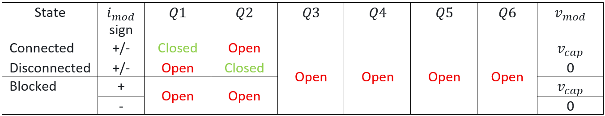

The module state is controlled using the board first leg (LEG1) switches Q1 and Q2 command (sw_{Q1} and sw_{Q2}):
Connected state:
- $sw_{Q1}=1$ (close Q1 MOSFET) and $sw_{Q2}=0$ (open Q2 MOSFET)
- The module is considered to be connected to the circuit, contributing to the stack with its capacitor voltage and the current pass through its capacitor.
Disconnected state:
- $sw_{Q1}=0$ (open Q1 MOSFET) and $sw_{Q2}=1$ (close Q2 MOSFET)
- The module is considered to be bypassed from the circuit having null voltage output and the current does not pass through its capacitor.
Blocked state:
- $sw_{Q1}=0$ (open Q1 MOSFET) and $sw_{Q2}=0$ (open Q2 MOSFET)
- Since both switches gate commands are to be turned off, only the MOSFETs anti-parallel diodes conducts. Which diodes conducts will depend only if current sign is positive or negative.

All these different states are illustrated in the figure below according to the current sign:

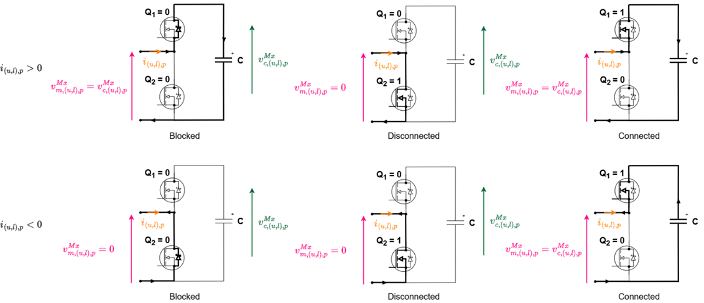

First, the individual module test is performed in low-frequency and then in high-frequency. The figure below shows the low-frequency test sequence. The user must manually TURN ON the udc power supply to start the sequence first part (positive current) and also TURN OFF udc to start the sequence second part (negative current).

 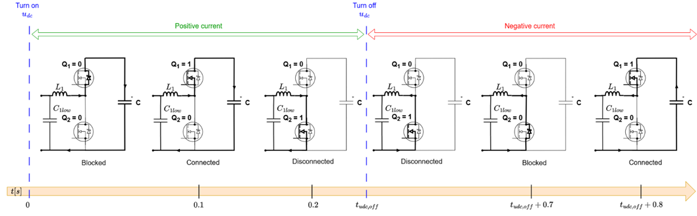

The difference between this test and the original low-frequency test is that the code was modified to no longer need programmable DC power supply.

## Required Hardware list:
- 1 TWIST boards with SPIN
- DC Power Supply (48 V, 2 A)
- Protection diode (at least 50 V)
- 2 resistors of 15 $\Omega$
- PC 64-bits (windows or linux)
- Oscilloscope
- Current probe
- 2 BNC adaptors to differential voltage measurement or differential probes

## Required Software list:
- Git
- Visual Studio Code with PlatformIO

If not done yet, you should do the [Getting started tutorial on how to setup VScode for OwnTech usage](https://github.com/analuhaas/MMC/blob/main/MMC_documentation/Getting%20started/Vscode_for_OwnTech_configuration.md).

## Get tutorial code from VScode

First, we need to load the Module test code from the OwnTech example repository version in https://github.com/analuhaas/examples 
1.	In VScode, open the folder where you previously cloned OwnTech’s github.
2.	In platformio.ini file, substitute the owntech_examples variable link by https://github.com/analuhaas/examples.git 
3.	Go to platform.io icon , go to Examples MMC JCGE under the Project Tasks tab and click on “MMC module JCGE – LF test (modified)”.
4.	Now you have the good code to execute the tutorial in your VScode.

## Minor hardware modifications and calibration

If not done yet:

- Recommended for a typical MMC behavior: configure the module board with the minor hardware modifications indicated in the [tutorial](../twist_modifications_MMC_module/twist_modifications_MMC_JCGE_tutorial.md).
- Calibrate the module sensors. You can do it in two ways:
    - manually, reading the measurements on the serial monitor and computing the gains and offsets in a spreadsheet, as explained in the [manual calibration tutorial](https://github.com/analuhaas/MMC/blob/main/MMC_documentation/Prototype%20tutorials/module_calibration_tutorial.md);
    - automatically, with MATLAB and a PicoScope acquiring the measurements and computing the gains and offsets, as explained in the [automated calibration tutorial](https://github.com/analuhaas/MMC/blob/main/MMC_documentation/Prototype%20tutorials/module_calibration_automated_tutorial.md).

## Hardware setup
5.	Recommended for MMC use: Configure the board to feed the 6 V auxiliary input externally with feeder completely disconnected from the electrical circuit of the board.
   In the TWIST board, it is possible to feed the auxiliary circuit of the board by 3 different ways:
  	* Using the feeder to provide the 6 V auxiliary input
  	* Feeding the 6 V auxiliary input externally
  	* Feeding the 6 V auxiliary input externally with feeder completely disconnected from the electrical circuit of the board.

The last one is preferable to MMC use cause the board feeder is not yet adapted to MMC charging phase. To do that:

- Connect an External Auxiliary DC Power Supply to the TWIST via the 6 V and DGND PINs. Make sure the External Auxiliary DC Power Supply is configured to deliver 6 V with limiting current above 0.5 A. Make sure this power supply OUTPUT IS OFF.

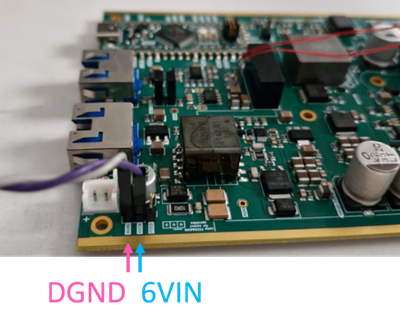

- Open the jumper JP5001 of the board by cutting the jumper connections using a cutter with an appropriate camera to see the area

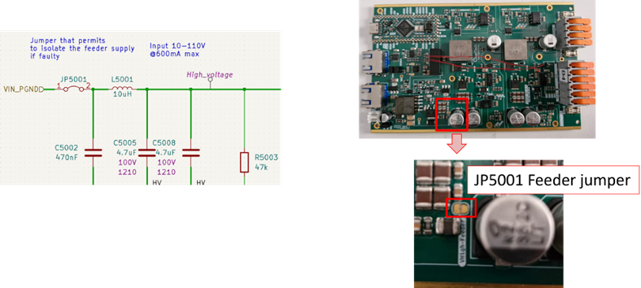

6.	Recommended for MMC use: Disconnect the electrolytical capacitor of both Low1 and Low2 terminals adding the following code lines in the setup_routine() function
```
 shield.power.disconnectCapacitor(LEG1);
 shield.power.disconnectCapacitor(LEG2);
```
 In the TWIST board electrical circuit, we see that Clow1 and Clow2 low-side capacitors are divided in a electrolytical part that is removable by Q5 and Q6 and a ceramic part. It is preferable that these capacitors are disconnected since they are not traditionally present in a Half-Bridge module circuit.

 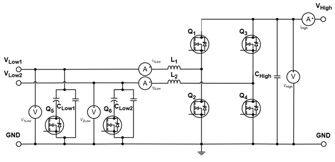

 7.	Connect the board with the power supply, the R and Rdec resistances, oscilloscope and PC as in the image: 
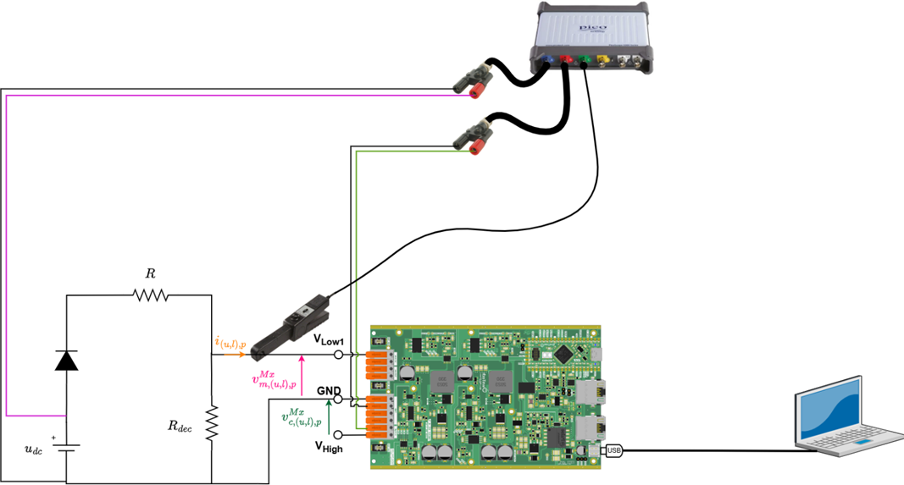

 After making the connections and connecting the PC to board the USB-C cable, you should have something like this:

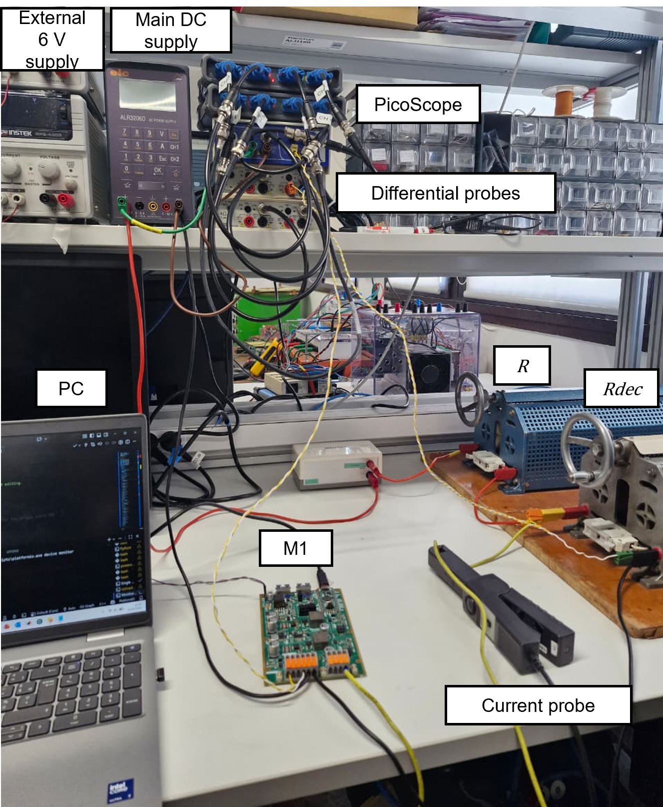

8.	Configure your Oscilloscope with PicoScope (tutorial using PicoScope 4444):

a.	Make sure it acquires the following measurements:

i.	Module capacitor voltage (Vhigh to GND).

ii.	Module current.

iii.	DC power supply voltage.

b.	Use a 500 ms/div configuration with sampling rate to have 5 µs sampling.
   
 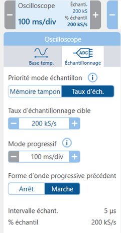
 
c.	Configure it to trigger when the power supply voltage rises up to 2 V.
  
 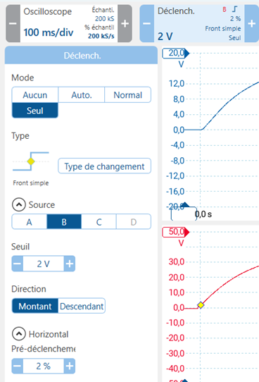

## Executing the LF module test

9.	Get the low-frequency test code using “MMC module JCGE– LF test” button.
10.	Build  and Upload 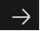 the code main.cpp into the board.
11.	Make sure the External Auxiliary DC Power Supply is configured to deliver 6 V with limiting current above 0.5 A. TURN ON the External Auxiliary DC Power Supply output.
The boards starts in IDLE mode (equal to module blocked state).
12.	TURN ON the main power supply output. This will start the sequence first part.
13.	After you verify the first sequence part is finished (after 0.5 s),  TURN OFF the main power supply output. This will start the sequence second part.
14.	TURN OFF the External Auxiliary DC Power Supply output.
15.	Save your oscilloscope data.

## Expected results

In the low-frequency sequence, the module expected behavior is as shown in the figure below.

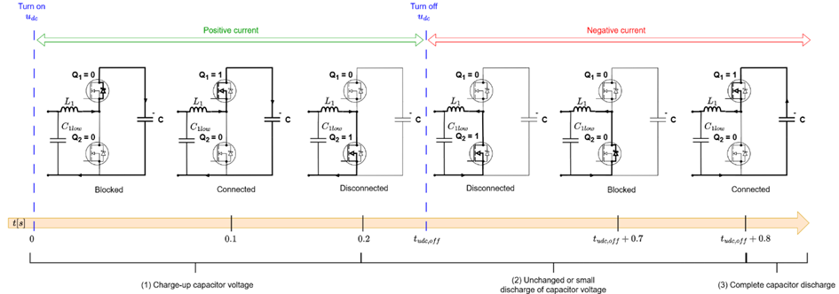

If you perform the low-frequency test with external 6V and feeder disconnected from the circuit, you should expect an experimental result like this:

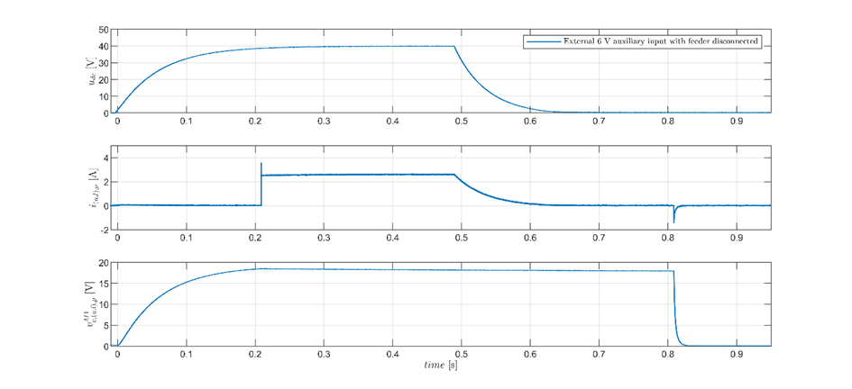

The use of external 6 V auxiliary input changes module discharge behavior while in disconnected state due to feeder behavior:

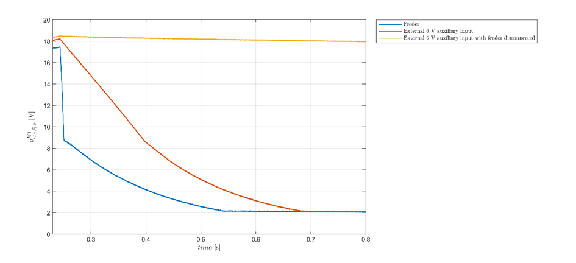
