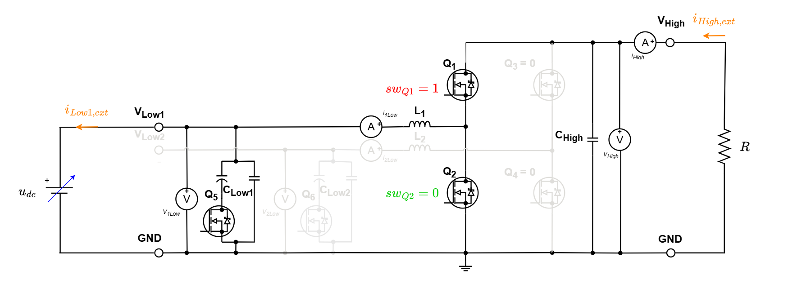
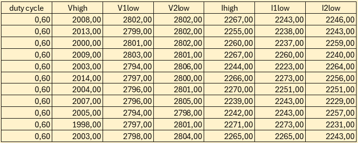
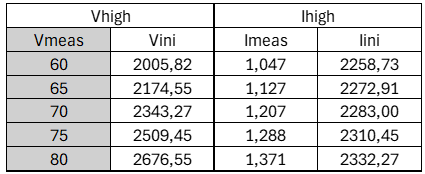
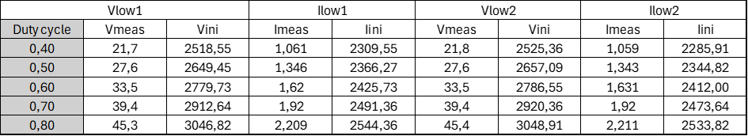

# Manual sensor calibration of the TWIST/SPIN board programmed as HB module

This example calibrates the six measurement chains of a TWIST board by hand:

| Sensor   | Measurement                  |
|----------|------------------------------|
| `V_HIGH` | High-side voltage            |
| `I_HIGH` | High-side current            |
| `V1_LOW` | Low-side voltage, leg 1      |
| `I1_LOW` | Low-side current, leg 1      |
| `V2_LOW` | Low-side voltage, leg 2      |
| `I2_LOW` | Low-side current, leg 2      |

Before moving on to any closed-loop control, the board's sensors must be calibrated. For each operating point, you:

1. drive the converter from the serial monitor,
2. read the raw board measurements on the serial monitor 10 times and take the mean,
3. measure the same signals with an external voltmeter and ammeter,
4. write the point in a spreadsheet (a [base spreadsheet](#using-the-base-spreadsheet) is provided),
5. compute the gain and offset with `SLOPE`/`INTERCEPT` and write the `setConversionParametersLinear()` lines in the firmware.

An automated version of this procedure, using MATLAB and a PicoScope, is given in [module_calibration_automated](../../MMC/Educational_prototype/module_calibration_automated/README.md). Both use the same circuit and the same method; only the acquisition of the measurements differs.

## What is sensor calibration?

The board converts each raw ADC value into a physical value with a linear law:

$$X_{real} = gain \cdot X_{raw} + offset$$

- $X_{raw}$: raw value measured by the board sensor
- $X_{real}$: actual voltage or current, here measured by the external voltmeter or ammeter
- $gain$ and $offset$: the correction factors to determine

The firmware of this example sets every sensor to `gain = 1` and `offset = 0`, so the values it prints are the raw ADC values. For each sensor, the spreadsheet fits the line $X_{meas} = gain \cdot X_{raw} + offset$ over all the points recorded, which gives the two factors directly.

## Required hardware

- 1 TWIST board (SPIN + TWIST shield)
- A DC power supply (0–48 V, current limited)
- A resistive load (or a DC electronic load)
- 2 voltmeters and 2 ammeters (or one multimeter, moved from one measurement to the next at each point)
- A 64-bit PC (Windows or Linux) with a USB connection to the board

## Required software

- Git
- Visual Studio Code with PlatformIO, to flash the firmware and use the serial monitor
- A spreadsheet software (Excel, LibreOffice Calc, ...)

If not done yet, you should do the [Getting started tutorial on how to setup VScode for OwnTech usage](https://github.com/analuhaas/MMC/blob/main/MMC_documentation/Getting%20started/Vscode_for_OwnTech_configuration.md).

## Get tutorial code from VScode

First, we need to load the Manual module calibration code from the OwnTech example repository version in https://github.com/analuhaas/examples
1.	In VScode, open the folder where you previously cloned OwnTech’s github.
2.	In platformio.ini file, substitute the owntech_examples variable link by https://github.com/analuhaas/examples.git
3.	Click on platform.io icon , go to Examples MMC JCGE under the Project Tasks tab and click on “Manual module calibration”. Now you have the good code to execute the tutorial in your VScode.

## Files checklist

Before starting, check that the `src` folder of your project contains the file of this example:

```text
src/
└── main.cpp
```

- [ ] `main.cpp`

## Hardware setup

The board is programmed as a half-bridge (HB) module and **fed from the low side**. In power mode, the high switch of one leg is kept closed (duty cycle = 1) and the low switch open, so the leg connects the low side directly to the high side:

- the power supply `Udc` feeds `VLow1` (or `VLow2`),
- the current flows through the inductor and the closed high-side switch to `VHigh`,
- the resistive load `R` is connected between `VHigh` and `GND`.

The same current then flows through the low-side and high-side current sensors, and $V_{HIGH} \approx V_{LOW}$. Each operating point is obtained by changing the supply voltage `Udc`, which changes the voltages and the load current together. The duty cycle always stays at 1.



The calibration is done in two runs, one per leg:

| Run  | Supply connected to | Board mode           | Sensors calibrated                     |
|------|---------------------|----------------------|----------------------------------------|
| LOW1 | `VLow1` – `GND`     | 1: `LEG1` at duty 1  | `V_HIGH`, `I_HIGH`, `V1_LOW`, `I1_LOW` |
| LOW2 | `VLow2` – `GND`     | 2: `LEG2` at duty 1  | `V_HIGH`, `I_HIGH`, `V2_LOW`, `I2_LOW` |

External measurement:

| Instrument  | LOW1 run                          | LOW2 run                          |
|-------------|-----------------------------------|-----------------------------------|
| Voltmeter 1 | `VHigh` – `GND` (`V_HIGH`)        | `VHigh` – `GND` (`V_HIGH`)        |
| Voltmeter 2 | `VLow1` – `GND` (`V1_LOW`)        | `VLow2` – `GND` (`V2_LOW`)        |
| Ammeter 1   | In series with the load, on `VHigh` (`I_HIGH`) | In series with the load, on `VHigh` (`I_HIGH`) |
| Ammeter 2   | In series with the supply, on `VLow1` (`I1_LOW`) | In series with the supply, on `VLow2` (`I2_LOW`) |

!!! warning Operating range
    - Limit the supply current to 5 A before switching it on.
    - Choose `R` so that the current stays within the current sensors' range. Currents below 1 A have a larger measurement error ([TWIST measurement chains](https://docs.owntech.org/1.0.0/twist/1.4.1/getting_started/#measurement-chains)), so spread the points over the range you will use, above 1 A when possible.
    - Keep the voltages and currents below 70 V and 6 A as limited by the board datasheet.

!!! tip Ammeter direction
    Connect each ammeter so that it reads a positive current in the same direction as the current sensor it is compared with on the board. An inverted ammeter gives a negative gain.

## Firmware

The firmware prints the raw measurements on the serial monitor and lets you choose the converter mode from the keyboard.

| File       | Content                                                                    |
|------------|----------------------------------------------------------------------------|
| `main.cpp` | Sensors with `gain = 1`, `offset = 0`; serial monitor prints; power modes  |

The sensors are set to `gain = 1` and `offset = 0` in `setup_routine()`:

```cpp
shield.sensors.setConversionParametersLinear(V_HIGH, 1, 0);
shield.sensors.setConversionParametersLinear(V1_LOW, 1, 0);
shield.sensors.setConversionParametersLinear(V2_LOW, 1, 0);
shield.sensors.setConversionParametersLinear(I1_LOW, 1, 0);
shield.sensors.setConversionParametersLinear(I2_LOW, 1, 0);
shield.sensors.setConversionParametersLinear(I_HIGH, 1, 0);
```

Serial monitor commands:

| Key | Mode                                  |
|-----|---------------------------------------|
| `i` | 0 = idle (PWM stopped)                |
| `1` | 1 = `LEG1` at duty cycle 1            |
| `2` | 2 = `LEG2` at duty cycle 1            |

Switching between modes always stops the PWM first, so the two legs are never driven at the same time. Press `h` to print the menu.

In modes 1 and 2, the LED is on and the raw values are printed every 100 ms, separated by `:`, in this order:

```text
V_HIGH:V1_LOW:V2_LOW:I_HIGH:I1_LOW:I2_LOW
```

Flash the firmware with the PlatformIO **Upload** button (environment `USB`) and open the serial monitor.

## Calibration procedure

### LOW1 run

1. Build and upload the code on the board, and open the serial monitor.
2. Wire the circuit with the power supply on `VLow1`, and the voltmeters and ammeters as in the measurement table.
3. Set the power supply to the first voltage and switch it on.
4. If necessary, feed the 6 V of your board with another power supply.
5. Press `1` in the serial monitor: `LEG1` starts at duty cycle 1.
6. For each supply voltage `Udc`:
    - read `V_HIGH`, `I_HIGH`, `V1_LOW` and `I1_LOW` on the serial monitor and take the mean of the last 10 values ($X_{raw}$);
    - read the voltmeters and the ammeters ($X_{meas}$);
    - write the point in the spreadsheet.
7. Press `i` to stop the converter, then switch off the power supply.

!!! warning Measurements variation
    The values printed on the serial monitor change a lot from one print to the next. Use the mean of the last 10 values for $X_{raw}$.

For example, the table below shows the last 10 values printed for a point where $V_{meas}$ = 60 V. Their mean gives $V_{raw}$ = 2005.82 and $I_{raw}$ = 2258.73.



### LOW2 run

1. Move the power supply from `VLow1` to `VLow2`, and move voltmeter 2 and ammeter 2 to `VLow2`.
2. Set the power supply to the first voltage and switch it on.
3. If necessary, feed the 6 V of your board with another power supply.
4. Press `2` in the serial monitor: `LEG2` starts at duty cycle 1.
5. For each supply voltage `Udc`, read `V_HIGH`, `I_HIGH`, `V2_LOW` and `I2_LOW` and the external instruments as in step 6 of the LOW1 run, and write the point in the spreadsheet.
6. Press `i` to stop the converter, then switch off the power supply.

!!! warning One sheet per run
    Write the LOW1 and LOW2 points in separate sheets. `V_HIGH` and `I_HIGH` are measured in both runs, so mixing the two runs would mix two sets of points for the same sensor.

### Computing the gain and offset

For each sensor, fit a line over the points of the spreadsheet, with the external measurement on the Y-axis and the raw board value on the X-axis:

$$X_{meas} = gain \cdot X_{raw} + offset$$

The gain and offset are given by the spreadsheet functions:

| Language | Gain                    | Offset                             |
|----------|-------------------------|------------------------------------|
| English  | `=SLOPE(Xmeas;Xraw)`    | `=INTERCEPT(Xmeas;Xraw)`           |
| French   | `=PENTE(Xmeas;Xraw)`    | `=ORDONNEE.ORIGINE(Xmeas;Xraw)`    |

Examples of spreadsheets:





The example spreadsheets give:

| Sensor   | Gain         | Offset        |
|----------|--------------|---------------|
| `V_HIGH` | 0.029826144  | 0.149339404   |
| `I_HIGH` | 0.004255763  | -8.543964735  |
| `V1_LOW` | 0.044704488  | -90.84268992  |
| `I1_LOW` | 0.00482212   | -10.07427637  |
| `V2_LOW` | 0.045023763  | -91.97069779  |
| `I2_LOW` | 0.004610542  | -9.478773207  |

### Using the base spreadsheet

A base spreadsheet, [Modules_calibration_20261009.xlsx](Modules_calibration_20261009.xlsx), is provided in the `module_calibration` folder. It averages the serial monitor values, fits the lines for the six sensors of up to 11 boards, compares the `V_HIGH` and `I_HIGH` results of the two runs, and writes the firmware lines for you. Make a copy of it for your calibration campaign.

| Sheet | What you do there |
|---|---|
| `Mesures Low1` / `Mesures Low2` | Paste the serial monitor lines of the LOW1 / LOW2 run |
| `Tables` | Type the voltmeter and ammeter readings; the raw board values are averaged automatically |
| `Curves Board n` | Read the gains and offsets, check the fits on the plots, and copy the firmware lines |

Each run has 5 points. For each board, the `Mesures` sheets have one block of columns (`Board n - Low1 run`), with rows 3–13 for point 1, 15–25 for point 2, 27–37 for point 3, 39–49 for point 4 and 51–61 for point 5.

1. **Paste the serial monitor values.** For each point of the LOW1 run, copy 11 lines printed by the serial monitor and paste them in the `Vhigh` column of your board in `Mesures Low1` (column C for board 1), in the rows of that point. You can write the supply voltage `Udc` of the point in the first column of the block, as a reminder.
2. **Split the values into columns.** Select the pasted cells and use *Data > Text to Columns*, type *Delimited*, delimiter `:`. The values fill the columns `Vhigh`, `V1low`, `V2low`, `Ihigh`, `I1low`, `I2low`, which follow the order printed by the firmware (`V_HIGH:V1_LOW:V2_LOW:I_HIGH:I1_LOW:I2_LOW`).
3. **Repeat for the LOW2 run** in `Mesures Low2`.
4. **Type the external measurements.** In `Tables`, go to the block of your board and type the voltmeter and ammeter readings of each point in the `Vmeas` / `Imeas` columns, one row per point (first row = point 1):
    - LOW1 run: `Vhigh`, `Ihigh`, `Vlow1` and `Ilow1` columns (marked `*`);
    - LOW2 run: `Vhigh`, `Ihigh`, `Vlow2` and `Ilow2` columns (marked `**`).

    The `Vini` / `Iini` columns are filled automatically with the mean of the 11 pasted values of each point. Replace the example values already in the `Vmeas` columns with your own readings.
5. **Check the results** in the `Curves Board n` tab of your board:
    - the plots show the points and the fitted line of each sensor; for `V_HIGH` and `I_HIGH`, the LOW1 and LOW2 runs are plotted as two series;
    - the gains and offsets are in `I2:I5` (`V_HIGH`, `I_HIGH` from the LOW1 run), `I7:I10` (`V_HIGH`, `I_HIGH` from the LOW2 run), `R2:R5` (`V1_LOW`, `I1_LOW`) and `T2:T5` (`V2_LOW`, `I2_LOW`);
    - `I13:I16` shows the difference between the two runs for `V_HIGH` and `I_HIGH`. A large difference usually means a wiring or measurement problem in one of the runs.
6. **Copy the firmware lines.** Cells `B33:B38` contain the six `setConversionParametersLinear()` lines, ready to paste in `setup_routine()` (with `V_HIGH` and `I_HIGH` from the LOW1 run). Cells `B41:B42` give the alternative `V_HIGH` and `I_HIGH` lines from the LOW2 run. The numbers are always written with a decimal point and the `F` suffix, whatever the language of your spreadsheet software.

!!! note Missing points
    The spreadsheet expects the 5 points of both runs. Until all the values of a sensor are filled, its gain and offset show an error and its firmware line shows `// <sensor>: no data yet`.

## Applying the calibration

Replace the `gain = 1`, `offset = 0` lines of `setup_routine()` in the firmware that will use the board by the values obtained (if you used the base spreadsheet, paste the lines of cells `B33:B38`):

```cpp
shield.sensors.setConversionParametersLinear(V_HIGH, <gain>, <offset>);
shield.sensors.setConversionParametersLinear(I_HIGH, <gain>, <offset>);
shield.sensors.setConversionParametersLinear(V1_LOW, <gain>, <offset>);
shield.sensors.setConversionParametersLinear(I1_LOW, <gain>, <offset>);
shield.sensors.setConversionParametersLinear(V2_LOW, <gain>, <offset>);
shield.sensors.setConversionParametersLinear(I2_LOW, <gain>, <offset>);
```

With the example values:

```cpp
shield.sensors.setConversionParametersLinear(V_HIGH, 0.029826144F, 0.149339404F);
shield.sensors.setConversionParametersLinear(I_HIGH, 0.004255763F, -8.543964735F);
shield.sensors.setConversionParametersLinear(V1_LOW, 0.044704488F, -90.84268992F);
shield.sensors.setConversionParametersLinear(I1_LOW, 0.00482212F, -10.07427637F);
shield.sensors.setConversionParametersLinear(V2_LOW, 0.045023763F, -91.97069779F);
shield.sensors.setConversionParametersLinear(I2_LOW, 0.004610542F, -9.478773207F);
```

`V_HIGH` and `I_HIGH` are calibrated in both runs. The two results should be close; use the run with the most points over the range you need, or compare them to check the setup.

You can now save your code by staging the changes and committing them.
