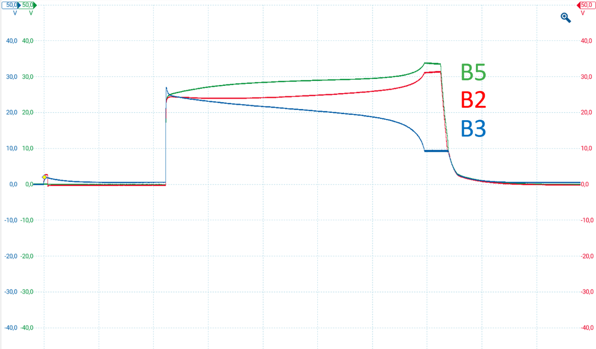
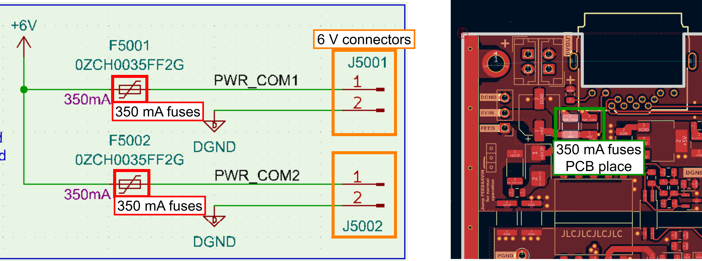
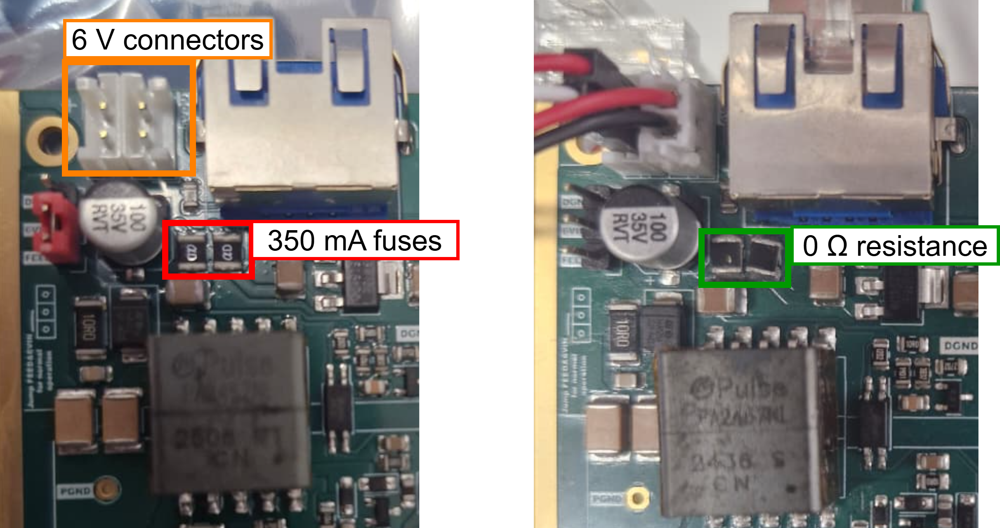
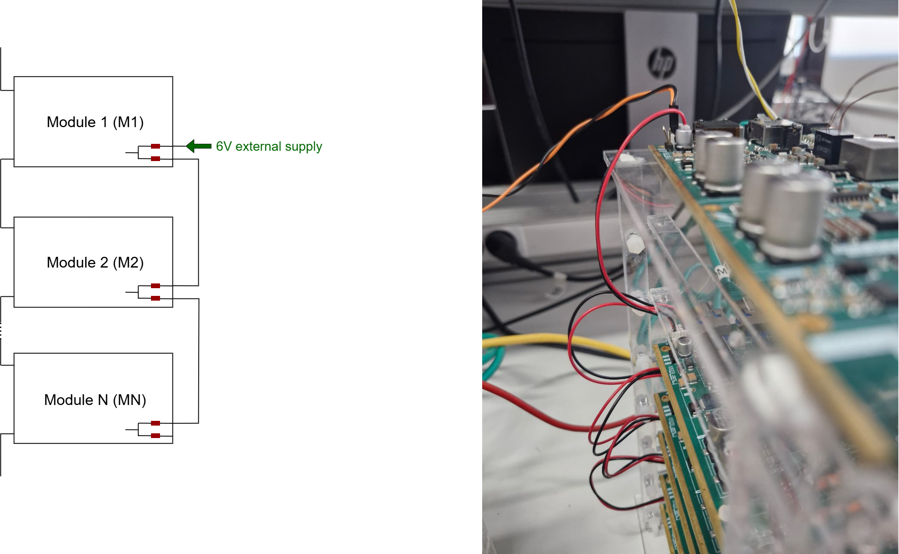
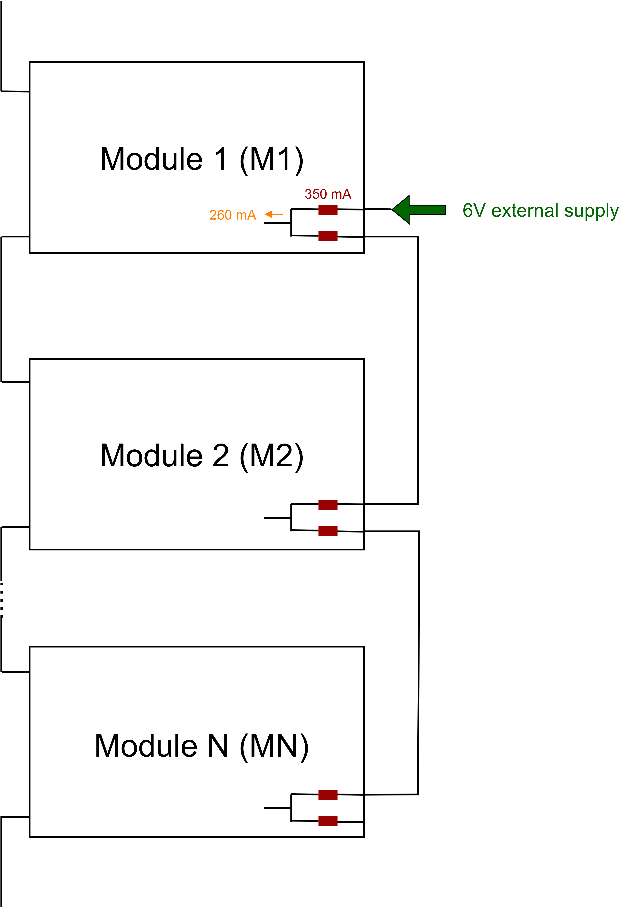
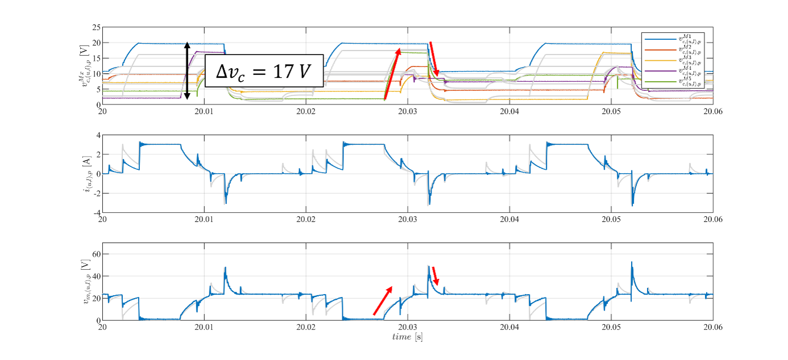

# Recommended modifications in TWIST boards to use them as MMC modules

The recommended hardware modifications of TWIST boards of version 1.4.3 or lower to serve as an MMC module are listed in this document.

Remark: this document cover the modifications done up to the JCGE conference. For more updated modifications, go to the [tutorial](https://github.com/analuhaas/MMC/blob/main/MMC_documentation/Prototype%20tutorials/twist_modifications_MMC_tutorial.md).

## Disconnect the internal APS from the power circuit

It is recommended for MMC use to configure the board to feed the 6 V auxiliary input externally with internal APS completely disconnected from the electrical circuit of the board. To do that:

- Open the jumper JP5001 of the board by cutting the jumper connections using a cutter with an appropriate camera to see the area

This is prefered since the board internal APS is not yet adapted to MMC charging phase, as explained below:

>The APS powers the auxiliary circuits of the module such as sensors, communication devices, gate drivers that commands the switching cells, etc. The APS is also called as Control power system (CPS) and Self-power supply in the literature. In the OwnTech suite, its called Feeder. 
>
>The APS can be fed externally by an DC isolated source or by the module capacitor. In our final prototype solution, we count to power the APS via the module capacitor. In this configuration, the APS can only start working when a minimum voltage is supplied by the capacitor. 
>
>The figure below shows an example of the APS influence during the startup of the MMC prototype. This test was done with 3 TWIST/SPIN modules (B2, B3, B5) connected in series. After simply applying a DC voltage on the converter DC terminals, we observe that while modules B2 and B5 charges, the module B3 discharges. This difference is likely related to a consumption difference between the modules APS.
>
> 
>
>This problem is currently being treated for the future version of the prototype. 

## Substitute the 6V input fuses by 0 Ohms resistances

Up to version 1.4.3 of the boards, it is necessary to substitute the black/green fuses of the 6 V supply by 0 Ohms resistances of 1210 size. To do it, follow the steps:

- Identify the fuses placement with the help of KICAD. Open both the schematic editor and the PCB editor correpondent to your board version. For help to access TWIST/OWNVERTER KICAD, go to this [OwnTech's KICAD tutorial](https://github.com/analuhaas/MMC/blob/main/MMC_documentation/Getting%20started/owntech_kicad_tutorial.md).

- The fuses are represented by the 350 mA fuse symbol in the figure below. Click on the fuse symbol using the schematic editor and it will indicate the right location in the PCB editor.

- Mount the 0 Ohms resistances in the place of the fuses. If you don't have 0 Ohms resistances, you can use small jumpers/wires instead.

- To test if the 0 Ohms resistances are well mounted, connect all boards 6 V inputs in series as shown in the figure below. Use a DC power supply configured for 6 V and current depending on the number of boards (1 board consumes ~0.3 on the 6 V input). TURN ON the DC power supply, you should see all boards LEDs light up.

This is modification facilitates the implementation of modular topologies, as explained below:

>The auxiliary circuits of the board are protected from possible high currents in the 6V input by fuses of 350 mA. However, since two fuses are placed just after the 6V IN and the DGND pins, they limit not only the current that goes to the board auxiliary circuits, but also the current that flows to other boards 6V inputs if connected in chain configuration, as shown in the figure below.
>
> 
>
>Since the auxiliary circuits of 1 board consumes around 260 mA, it is not possible to connect even 2 modules in a chain. That's why the substitution by 0 Ohms resistances is used.
>
>This problem can be easily diagnosed by observing if the modules LED's are in their full bright after connecting them to the 6 V external supply.
>
>This is a provisory solution. This problem is currently being treated for the future version of the prototype. 

## Increase module capacitance

The high-side capacitor $C_{High}$ is used as the module capacitor. Its capacitance of 188.6 $\mu$F is quite small and does not sustain enough energy for operation with power at 50 Hz.

To do that, it suffices to connect capacitors in parallel to $C_{High}$ using VHigh and GND terminals. We make available the [PCB KiCad project](https://github.com/analuhaas/MMC/blob/main/MMC_documentation/Prototype%20tutorials/KiCad_module_capacitor/README.md) used to add up to 4 560 µF capacitors of CHEMICON in parallel of reference 914-3692 at RS components. If you use other capacitor, make sure to adapt the capacitor holes size and spacement on the PCB. The final result is a tower stacking multiple capacitors, like shown in the figure below, that can be accomodates on the side of each stack.

>The main issue from this low capacitance is that the capacitors charges and discharges fast as shown in the figure below. This causes higher voltage ripple and a deformed stack voltage.
>
>
>
>As this behavior is not usual for an NLM MMC, it is recommended to increase the module capacitance.